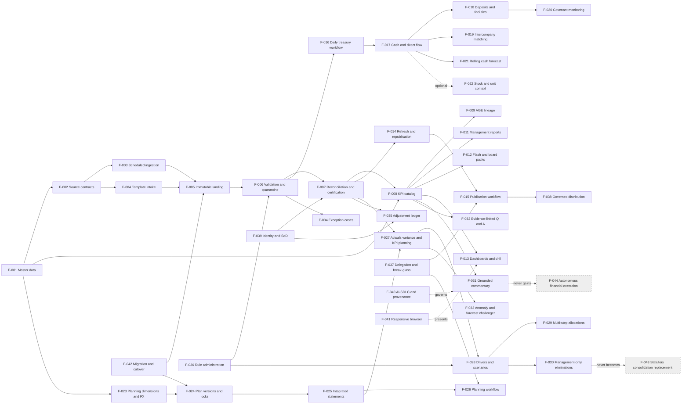
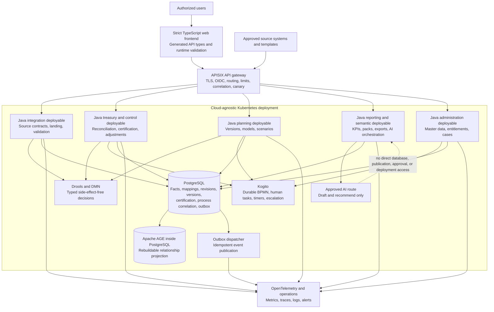
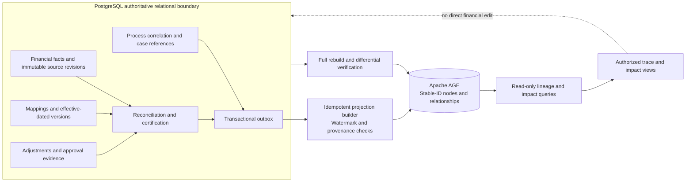
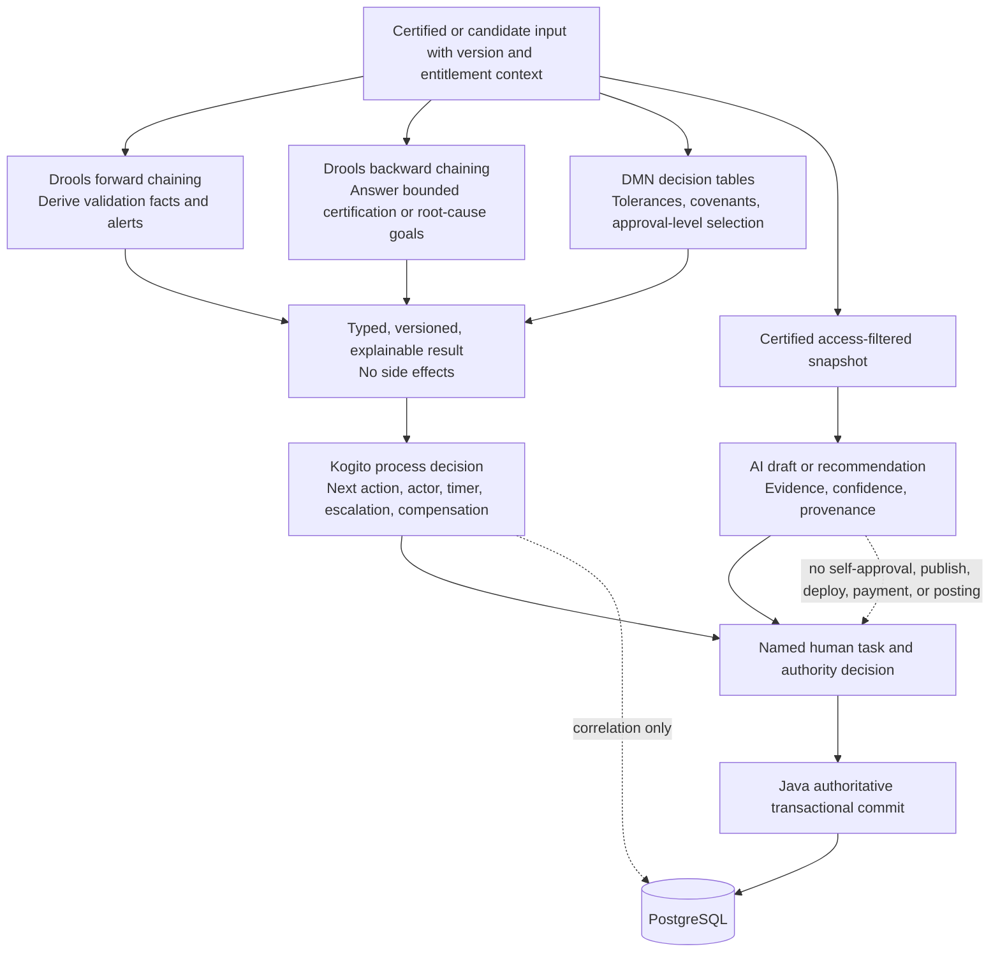
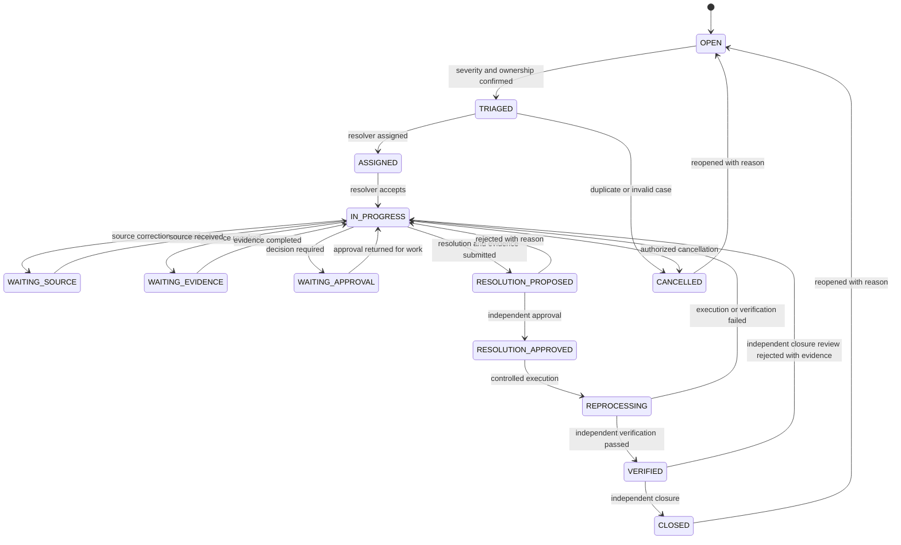
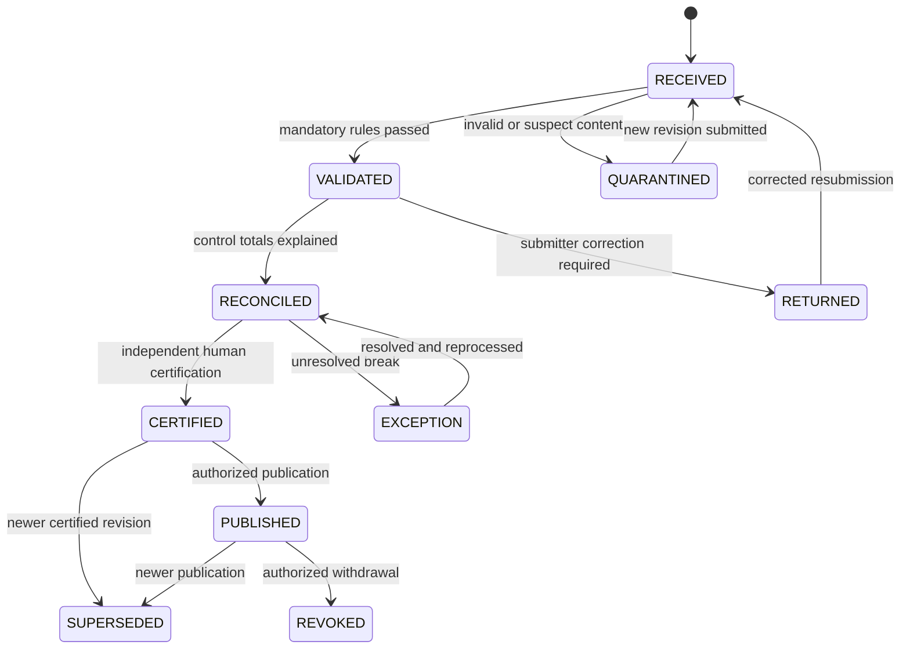
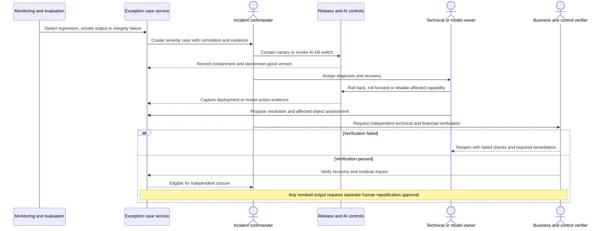
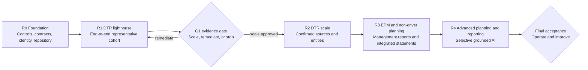

# AI-Empowered Financial Management Solution — Product Requirements Document

| Document control | Value |
|---|---|
| Version | v1.0 |
| Status | Draft |
| Author | Product Management |
| Date | 2026-10-31 |
| Audience | Product, Finance, Treasury, FP&A, Engineering, Security, Operations, and Assurance stakeholders |

> **Requirement convention:** “Must,” “Should,” “Could,” and “Won’t” follow MoSCoW. Every numeric service level, recovery objective, response target, adoption goal, and threshold in this document is a **proposed acceptance target**, not an achieved benchmark or a current-state claim. Targets require confirmation through baseline measurement, sizing, security review, and formal acceptance.

## 1. Product Context

### 1.1 Background

Finance teams often assemble management reporting, daily treasury positions, and plans from heterogeneous source systems and controlled spreadsheets. Repeated file handling, inconsistent mappings, unclear metric definitions, late submissions, and offline adjustments can weaken timeliness and traceability. The product will establish one governed financial data and workflow core for three experiences: enterprise performance reporting, daily treasury reporting, and integrated planning. It will complement rather than replace transactional accounting or statutory consolidation. Deterministic validation, reconciliation, certification, version control, and human approval precede publication. AI is optional assistance: it may draft commentary, answer bounded questions, or propose anomalies and forecast challenges only from certified, access-filtered snapshots. It cannot approve, post, pay, publish, deploy, or certify autonomously. Delivery starts with a controlled foundation and a daily treasury lighthouse, then scales through evidence-based release gates.

### 1.2 Objectives, North Star, and Success Metrics

**Product objective:** provide timely, reconciled, explainable financial information and connected planning while preserving accountable human decisions.

**User objective:** replace repetitive collection and reconciliation work with guided submission, exception-based resolution, reusable metrics, and authorized analysis.

**North Star:** the percentage of decision-critical financial data products that are certified and published within their approved cutoff with complete lineage and approval evidence.

| Outcome | Measure | Proposed acceptance target | Evidence |
|---|---|---:|---|
| Trusted reporting | Certified executive KPIs with owner, formula, grain, lineage, and access policy | 100% of in-scope KPIs | Semantic catalog and certification report |
| Timely treasury | Certified daily position after the last valid on-time submission | ≤ 60 minutes | Timestamped pipeline and publication logs |
| Submission quality | In-scope submissions receiving validation and reconciliation outcomes | 100% | Load and reconciliation registers |
| Planning agility | Standard non-driver planning cycle after stabilization | ≤ 5 business days, subject to baseline | Calendar, task, and approval timestamps |
| Controlled change | Material adjustments with four-eyes approval and complete evidence | 100% | Adjustment ledger and access log |
| Adoption | Recurring in-scope packs produced from the governed platform | ≥ 90% by the end of R4 | Publication inventory and usage telemetry |
| AI fidelity when enabled | Numeric statements matching cited certified evidence in the release evaluation set | 100%; unsupported claims blocked | Versioned AI evaluation report |
| Operational reliability | Monthly service availability excluding approved maintenance | ≥ 99.9% | Independently reproducible SLO report |

### 1.3 Scope

**In scope**

- Effective-dated financial master data, source contracts, scheduled and template ingestion, immutable landing, validation, reconciliation, certification, KPI semantics, lineage, and audit.
- Enterprise and division management reporting, flash and board-style packs, dashboards, authorized drill-down, refresh, commentary, publication, and action tracking.
- Daily treasury submissions, cash and direct cash flow, deposits, facilities, intercompany matching, covenant monitoring, rolling forecasts, and optional stock/unit liquidity information.
- Budget and Forecast versions, non-driver integrated P&L/BS/CF planning, actuals variance, drivers and scenarios, allocations, and management-only intercompany eliminations.
- Deterministic and grounded AI assistance, exception cases, controlled adjustments, rule/process administration, identity and access governance, migration, and cutover.
- Cloud-agnostic Kubernetes deployment with PostgreSQL, Apache AGE, APISIX, Java, strict TypeScript, Drools/DMN, and Kogito under explicit responsibility boundaries.

**Out of scope for this product cycle**

- Replacement of transactional accounting, operational source applications, or statutory consolidation (F-043).
- Autonomous payments, general-ledger posting, financial approvals, publication, certification, or production deployment (F-044).
- Native mobile applications; F-041 is limited to a responsive mobile-browser experience.
- Ungrounded AI, unrestricted natural-language database execution, and arbitrary user-supplied SQL, Cypher, or DRL.
- Unapproved historical-depth expansion, new source populations, or additional statutory jurisdictions without impact assessment.

## 2. Personas

| Persona | Role and core goal | Primary pain point | Required outcome |
|---|---|---|---|
| **Executive & Assurance** | Consumes certified enterprise information and tests whether figures, decisions, and controls are defensible. | Inconsistent packs and limited evidence behind reported numbers. | Timely, comparable outputs with visible certification, lineage, approvals, and accountable actions. |
| **Group Finance/EPM & Data Stewardship** | Owns enterprise definitions, mappings, reporting, data quality, and certification. | Repeated reconciliation and report-local definitions across sources. | One governed semantic and control core reusable across products. |
| **Treasury** | Owns daily liquidity, cash movement, funding headroom, intercompany positions, forecasts, and covenant oversight. | Time-sensitive submissions and fragmented bank/entity information. | Certified daily positions and actionable exceptions within the treasury cutoff. |
| **FP&A/Planning** | Owns Budgets, Forecasts, integrated statements, planning calendar, scenarios, and performance dialogue. | Disconnected plans, actuals, drivers, and versions. | Governed, integrated planning with reproducible versions and rapid variance analysis. |
| **Divisional/Entity Finance** | Submits, reviews, corrects, explains, and approves entity or divisional information. | Unclear rejection reasons, repeated requests, and offline approvals. | Guided tasks, actionable errors, controlled resubmission, and transparent approval status. |

Technology, security, operations, and audit responsibilities are embedded in the stories, acceptance criteria, NFRs, and human-authority controls rather than represented as additional personas.

## 3. User Stories and Story Map

Each story is independently valuable, negotiable in implementation, estimable from its acceptance boundary, small enough for one release increment, and testable through its mapped feature criteria.

### 3.1 Executive & Assurance

| ID | INVEST user story | Independent value and test focus | Mapped features |
|---|---|---|---|
| **US-001** | As an Executive & Assurance user, I want certified enterprise packs with reviewed commentary, so that I can make decisions from figures whose status and ownership are clear. | A complete pack can be accepted without relying on another story; verify certification, deterministic figures, and publication approval. | F-007, F-008, F-011, F-012, F-015, F-031 |
| **US-002** | As an Executive & Assurance user, I want to drill from a KPI to governed evidence and ask bounded questions, so that I can understand movements without requesting a new extract. | A single KPI investigation is independently usable; verify drill, lineage, access filtering, and evidence-linked answers. | F-009, F-012, F-013, F-032, F-038 |
| **US-003** | As an Executive & Assurance user, I want exceptions, access changes, and adjustments to have durable ownership and approval evidence, so that I can assess control effectiveness. | One control review stands alone; verify case state, segregation of duties, access review, and immutable history. | F-010, F-034, F-035, F-039 |

### 3.2 Group Finance/EPM & Data Stewardship

| ID | INVEST user story | Independent value and test focus | Mapped features |
|---|---|---|---|
| **US-004** | As a Group Finance/EPM & Data Stewardship user, I want effective-dated master data and authoritative source contracts, so that historical and current reports use the intended structures. | A hierarchy or mapping change can be tested independently; verify effective dates, provenance, and version history. | F-001, F-002, F-010, F-036 |
| **US-005** | As a Group Finance/EPM & Data Stewardship user, I want scheduled and template data to be validated, reconciled, and refreshed through one control path, so that only trusted data reaches reports. | One source load demonstrates end-to-end value; verify landing, quarantine, reconciliation, certification, and republication. | F-002, F-003, F-004, F-005, F-006, F-007, F-014, F-042 |
| **US-006** | As a Group Finance/EPM & Data Stewardship user, I want a certified KPI catalog and governed rule changes, so that every product calculates the same measure consistently. | One KPI can be defined and reused independently; verify formula ownership, simulation, lineage, and documentation. | F-008, F-009, F-036, F-040 |

### 3.3 Treasury

| ID | INVEST user story | Independent value and test focus | Mapped features |
|---|---|---|---|
| **US-007** | As a Treasury user, I want guided daily submissions that produce a certified cash position and direct cash flow, so that I can monitor liquidity before the daily cutoff. | One daily cycle is independently valuable; verify timeliness, continuity, late handling, and reconciliation. | F-006, F-007, F-016, F-017, F-034 |
| **US-008** | As a Treasury user, I want deposits, facilities, intercompany loans, and covenant measures reconciled in one view, so that I can manage headroom and mismatches proactively. | A funding position can be assessed alone; verify utilization, matching, versioned parameters, and alerts. | F-018, F-019, F-020 |
| **US-009** | As a Treasury user, I want a configurable rolling cash forecast with optional stock/unit liquidity context, so that I can challenge future liquidity using current assumptions. | One forecast version is independently testable; verify horizon, actual comparison, and optional operational context. | F-021, F-022, F-033 |

### 3.4 FP&A/Planning

| ID | INVEST user story | Independent value and test focus | Mapped features |
|---|---|---|---|
| **US-010** | As an FP&A/Planning user, I want shared dimensions, multi-currency rules, and seeded Budget/Forecast versions, so that plans are comparable with actuals and across entities. | A new version can be created independently; verify seeding, FX basis, locks, and lineage. | F-001, F-010, F-023, F-024 |
| **US-011** | As an FP&A/Planning user, I want non-driver inputs to generate integrated P&L, balance sheet, and cash flow through a managed calendar, so that I can run a controlled planning cycle without offline consolidation. | One planning cycle is independently completable; verify statement integrity, tasks, approvals, and locks. | F-024, F-025, F-026, F-037 |
| **US-012** | As an FP&A/Planning user, I want actuals variance, KPI planning, drivers, scenarios, allocations, and management-only eliminations, so that I can evaluate alternatives and explain performance. | Each model increment has separable value and acceptance; verify calculation integrity and reproducibility. | F-027, F-028, F-029, F-030, F-033 |

### 3.5 Divisional/Entity Finance

| ID | INVEST user story | Independent value and test focus | Mapped features |
|---|---|---|---|
| **US-013** | As a Divisional/Entity Finance user, I want validated templates with precise errors and controlled resubmission, so that I can correct data without repeated offline exchanges. | One submission and correction journey stands alone; verify original preservation, row-level errors, and revision handling. | F-004, F-005, F-006 |
| **US-014** | As a Divisional/Entity Finance user, I want clear tasks, commentary, review, delegation, and escalation, so that I can complete my responsibilities on time even when ownership changes. | One assigned workflow is independently testable; verify comments, reminders, delegation, and rejection handling. | F-015, F-016, F-026, F-037 |
| **US-015** | As a Divisional/Entity Finance user, I want governed adjustments, exports, and browser access, so that I can resolve and share authorized information without uncontrolled copies or device constraints. | One adjustment or export can be accepted independently; verify four-eyes approval, distribution scope, action tracking, and responsive behavior. | F-035, F-038, F-041 |

### 3.6 Journey Story Map

| Journey stage | Discover and define | Submit and validate | Reconcile and decide | Publish and analyze | Improve and govern |
|---|---|---|---|---|---|
| Primary stories | US-004, US-006, US-010 | US-005, US-007, US-011, US-013 | US-003, US-008, US-014, US-015 | US-001, US-002, US-009, US-012 | US-003, US-005, US-006, US-014 |
| Critical path | Authoritative definitions → | Immutable, valid input → | Reconciled, approved outcome → | Certified, access-filtered consumption → | Evidence-led corrective action |

## 4. Functional Requirements and MoSCoW Matrix

### 4.1 Feature Catalogue

“Input / Output / Interaction” describes the externally observable product contract. Priorities apply to the current product cycle; Won’t items are explicit exclusions and require no acceptance criteria.

| ID | Feature | Description | Input | Output | Interaction | Stories | Priority and rationale |
|---|---|---|---|---|---|---|---|
| **F-001** | Master data and effective-dated hierarchies | Maintains entities, charts, cost/profit centers, management dimensions, mappings, and multiple effective-dated roll-ups. | Master records, mappings, effective dates, approvals. | Versioned dimensions and validated hierarchy resolutions. | Stewards propose, compare, approve, activate, and roll back through governed views. | US-004, US-010 | **Must** — common financial identity is prerequisite to every product. |
| **F-002** | Authoritative source register and data contracts | Registers each source’s owner, grain, fields, precedence, cadence, cutoff, quality, reconciliation, and retention contract. | Source metadata, ownership, schema, control totals, policy. | Approved source contract and compatibility status. | Owners version, review, diff, approve, and deprecate contracts. | US-004, US-005 | **Must** — authoritative provenance prevents ambiguous ingestion and certification. |
| **F-003** | Scheduled source ingestion | Executes contracted API, file, and managed-feed ingestion with scheduling, retries, dependency checks, and monitoring. | Source extracts, schedules, credentials by reference, contract version. | Run status, landed batches, freshness, and error notifications. | Operators schedule, pause, replay, and inspect authorized runs. | US-005 | **Must** — repeatable acquisition is required for sustainable reporting. |
| **F-004** | Validated template intake and resubmission | Accepts versioned spreadsheets/CSV and structured forms with schema checks, actionable errors, and controlled replacement submissions. | Template, form values, source period, submitter declaration. | Acceptance/rejection, cell/row errors, submission and revision IDs. | Submitters upload, validate, correct, resubmit, and track status. | US-005, US-013 | **Must** — controlled fallback is necessary where direct feeds are unavailable. |
| **F-005** | Immutable landing and load logs | Preserves original payloads and records source, hashes, timestamps, runs, counts, rules, and processing outcomes without overwrite. | Source payload, metadata, run context, content hash. | Immutable batch record and queryable load evidence. | Authorized users inspect lineage and auditors export evidence. | US-005, US-013 | **Must** — reproducibility and forensic review depend on original evidence. |
| **F-006** | Validation and quarantine | Applies completeness, type, sign, range, duplicate, period, referential, currency, and cross-schedule rules before certification. | Landed records, rule version, tolerances, source contract. | Pass/fail results, quarantined rows, rule explanations, cases. | Submitters correct errors; stewards manage exceptions without bypassing evidence. | US-005, US-007, US-013 | **Must** — invalid facts must not contaminate certified products. |
| **F-007** | Reconciliation and certification | Compares source, loaded, transformed, and aggregate control totals and blocks certification for unexplained differences. | Validated data, control totals, tolerances, evidence, approver decision. | Reconciliation statement, certification status, blocked/approved result. | Preparers resolve breaks; independent certifiers approve or reject. | US-001, US-005, US-007 | **Must** — financial publication requires a defensible trust gate. |
| **F-008** | Certified KPI and semantic catalog | Defines unique KPI IDs, formulas, units, grains, dimensions, owners, cadence, sensitivity, versions, and permitted drill paths. | KPI cards, worked examples, mappings, thresholds, approvals. | Reusable certified measures and semantic metadata. | Owners propose, test, certify, deprecate, and compare definitions. | US-001, US-006 | **Must** — shared meaning eliminates report-local calculation forks. |
| **F-009** | AGE lineage and impact analysis | Projects stable-ID hierarchy, transformation, KPI, report, and intercompany relationships into Apache AGE for trace and impact queries. | Relational change sets, stable IDs, provenance, watermarks. | Rebuildable graph projection, upstream/downstream paths, impact lists. | Users trace figures and stewards assess proposed change blast radius. | US-002, US-006 | **Should** — materially improves explainability but relational evidence remains authoritative. |
| **F-010** | Version and audit history | Records who changed what, when, why, before/after values, approvals, and revision relationships across governed objects. | Change events, actor, reason, old/new values, retention policy. | Immutable audit trail, version comparison, restoration reference. | Users compare versions; authorized auditors search and export history. | US-003, US-004, US-010 | **Must** — accountability and reproducibility are mandatory. |
| **F-011** | Enterprise and division management reports | Assembles governed enterprise, division, and entity management reports from shared actuals, plans, KPIs, and commentary. | Certified data products, report configuration, commentary, version. | Consistent management pack with visible status and freshness. | Users filter, compare, review, generate, and reproduce published editions. | US-001 | **Must** — core recurring management outcome. |
| **F-012** | Flash, business, and board packs | Provides configurable concise flash, operational business, and board-style packs using the same certified data and narrative workflow. | Pack layout, certified measures, comparisons, approved commentary. | Versioned decision packs in authorized formats. | Owners assemble, review, approve, export, and distribute packs. | US-001, US-002 | **Should** — high-value presentation reuse following management-report stability. |
| **F-013** | Dashboards, drill, and self-service | Offers certified dashboards, pivot-style slicing, authorized filters, and drill to the lowest available governed grain. | Semantic query selections, filters, user entitlements. | Interactive visualizations, detail rows, freshness and certification labels. | Users slice, drill, save views, and export without local KPI redefinition. | US-002 | **Should** — improves analysis while static packs provide a short-term alternative. |
| **F-014** | Weekly/monthly refresh and republication | Refreshes weekly key KPIs and monthly primary products, propagates revisions, and republishes affected outputs under version control. | Refresh schedule, changed data, revision cutoff, approval. | Fresh certified products, restatement versions, publication status. | Operators refresh, compare, approve, republish, and roll back outputs. | US-005 | **Must** — recurring reporting requires controlled change propagation. |
| **F-015** | Commentary, review, and publication workflow | Routes narrative and report editions through draft, review, approval, publication, rejection, and controlled supersession. | Commentary, report edition, reviewers, decision, evidence. | Approved narrative, publication state, review trail. | Authors draft; reviewers comment; independent approvers publish or return. | US-001, US-014 | **Must** — accountable narrative and release decisions are core controls. |
| **F-016** | Daily treasury submission workflow | Coordinates entity calendars, daily tasks, cutoffs, reminders, late/missing queues, review, and resubmission. | Treasury templates/feeds, entity calendar, cutoff, task owners. | Daily completion matrix, late alerts, submission status. | Entities submit; Treasury reviews, returns, escalates, and monitors. | US-007, US-014 | **Must** — daily treasury depends on complete and timely participation. |
| **F-017** | Cash position and direct cash flow | Calculates opening/closing cash, bank balances, receipts/payments, and movement by entity, account, currency, and category. | Certified cash/bank inputs, FX, categories, prior close. | Reconciled cash position, direct cash-flow statement, movement bridge. | Users analyze, drill, compare, certify, and publish daily positions. | US-007 | **Must** — foundational treasury decision product. |
| **F-018** | Deposits, facility limits, utilization, and headroom | Maintains deposit schedules and facility terms and calculates limits, utilization, availability, maturity, and headroom. | Deposit/facility records, balances, rates, currencies, effective terms. | Deposit schedule, utilization and headroom summaries, anomaly alerts. | Treasury edits by workflow, reconciles, drills, and certifies positions. | US-008 | **Must** — liquidity and funding decisions require reliable available headroom. |
| **F-019** | Intercompany loan matching | Matches both sides of intercompany loans by counterparty, amount, currency, rate, and tenor and manages mismatches. | Entity/counterparty loan records, matching keys, tolerances. | Matched positions, differences, ageing, resolution evidence. | Entity owners explain; Treasury reviews and resolves mismatches. | US-008 | **Should** — important control that can initially operate on representative pairs. |
| **F-020** | Versioned gearing and covenant monitoring | Calculates approved actual/forecast gearing and covenant metrics using effective-dated parameters and thresholds. | Debt/cash/equity inputs, formula cards, covenant versions, scenarios. | Ratio, headroom, threshold status, evidence and alerts. | Treasury maintains versions, tests examples, reviews alerts, and approves publication. | US-008 | **Should** — high-value risk oversight after core cash and debt are trusted. |
| **F-021** | Configurable rolling cash forecast | Supports configurable horizons and cadences, seeded direct forecasts, revisions, and actual-versus-forecast comparisons. | Forecast receipts/payments, opening cash, horizon, assumptions, actuals. | Rolling forecast, closing liquidity, variance and version history. | Owners seed, edit, submit, approve, compare, and roll forward. | US-009 | **Should** — forward visibility is important but follows daily-position stabilization. |
| **F-022** | Stock/unit liquidity information | Presents optional stock/unit quantities, ageing, movements, and related liquidity context where authorized sources exist. | Stock/unit inputs, dates, classifications, optional allocations. | Operational liquidity views and source-quality labels. | Users filter, compare, and drill to submitted detail. | US-009 | **Could** — useful context, not required for the core cash position. |
| **F-023** | Planning dimensions and multi-currency | Reuses planning dimensions and applies approved transaction/local/group currency and FX assumption rules. | Dimensions, planning values, currencies, FX versions, conversion rules. | Comparable plans with visible currency and FX basis. | Planners select versions and analyze translated outputs within entitlements. | US-010 | **Must** — consistent structure and currency are essential to integrated planning. |
| **F-024** | Budget/Forecast versions, seeding, and locks | Creates governed versions seeded from Actuals or prior plans, supports comparison, approval locks, and controlled reopening. | Source version, seed rules, assumptions, approvals, unlock reason. | Immutable plan versions, comparisons, lock/reopen audit. | Planners copy, edit, submit, approve, lock, and request reopening. | US-010, US-011 | **Must** — planning requires reproducible scenario and approval boundaries. |
| **F-025** | Non-driver inputs and integrated P&L/BS/CF | Captures revenue, operating cost, capital, and workforce schedules and generates linked P&L, balance sheet, and cash-flow outputs. | Non-driver schedules, mappings, opening balances, accounting rules. | Integrated statements, balance checks, cash-flow integrity results. | Planners input, validate, recalculate, review, and resolve imbalances. | US-011 | **Must** — integrated statements are the central planning outcome. |
| **F-026** | Planning calendar, tasks, approvals, and reminders | Manages planning milestones, task ownership, multi-level approvals, status, reminders, and overdue visibility. | Calendar, tasks, owners, approval levels, notification rules. | Progress board, decisions, reminders, escalation records. | Participants complete tasks; reviewers return or approve; owners monitor. | US-011, US-014 | **Must** — planning cannot operate reliably without coordinated accountability. |
| **F-027** | Actuals variance and KPI planning | Compares Actual, Budget, Forecast, and prior periods and plans financial/operational KPIs on the shared catalog. | Certified actuals, plan versions, KPI definitions, thresholds. | Amount/percentage variances, KPI plans, drillable commentary. | Users compare, drill, annotate, and assign follow-up actions. | US-012 | **Should** — key analytical enhancement after base planning is operational. |
| **F-028** | Drivers and what-if scenarios | Maintains approved operational/financial drivers and isolated scenario copies with overrides and side-by-side comparison. | Driver values, formulas, scenario assumptions, baseline version. | Recalculated scenarios, sensitivities, comparison outputs. | Planners simulate, compare, review, and approve selected scenarios. | US-012 | **Should** — significant planning value after non-driver model proof. |
| **F-029** | Multi-step allocations | Executes configurable multi-step/step-down allocations with preserved totals and source-to-receiver traceability. | Cost pools, receivers, drivers, sequence, rule version. | Allocation ledger, reconciled totals, trace paths. | Model owners simulate, approve, run, reverse, and inspect allocations. | US-012 | **Could** — valuable for selected models but not required for initial planning. |
| **F-030** | Intercompany planning and management-only eliminations | Plans intercompany sales/recharges/fees, matches differences, and applies traceable management-view eliminations. | Counterparty plans, matching rules, elimination rules, versions. | Mismatch report and management-only eliminated outputs. | Entity planners reconcile; FP&A reviews and approves management views. | US-012 | **Could** — specialized enhancement explicitly distinct from statutory consolidation. |
| **F-031** | Deterministic and grounded AI commentary | Produces deterministic narrative first and optional AI drafts from certified, access-filtered snapshots with cited figures and human review. | Certified metrics, variances, approved narrative rules, snapshot ID. | Evidence-linked draft, unsupported-claim flags, approval disposition. | Authors edit or reject; named approvers decide publication. | US-001 | **Should** — improves narrative efficiency while deterministic fallback remains available. |
| **F-032** | Evidence-linked natural-language KPI Q&A | Answers bounded questions through governed semantic tools with row-level access and evidence links, never arbitrary database queries. | Natural-language question, user context, certified snapshot. | Answer, KPI/version/period basis, evidence links, or safe refusal. | Users ask, inspect evidence, provide feedback, and escalate invalid answers. | US-002 | **Could** — optional convenience after semantic and AI controls mature. |
| **F-033** | Anomaly detection and forecast challenger | Recommends unusual movements and alternative forecast challenges with explanations, confidence, and comparison evidence. | Certified history, current values, model/rule version, forecast. | Ranked alerts or challenger forecast with rationale and evaluation. | Analysts accept, dismiss, annotate, or escalate; no automatic plan change. | US-009, US-012 | **Could** — decision support only; deterministic processes remain sufficient. |
| **F-034** | Exception case management | Creates durable cases for validation, reconciliation, lateness, workflow, model, and operational exceptions with SLA and evidence. | Exception event, severity, object reference, owners, evidence. | Case state, actions, timers, escalation, resolution and closure record. | Owners triage, assign, resolve, verify, reopen, and independently close. | US-003, US-007 | **Must** — controlled exception resolution is essential to sustainable operation. |
| **F-035** | Manual adjustment ledger and four-eyes approval | Records proposed management adjustments separately and applies approved, reversible entries without overwriting source facts. | Adjustment lines, reason, evidence, period, preparer and approver. | Ledger entries, approval state, reversal links, adjusted bridge. | Preparer proposes; independent approver approves/rejects; users reverse by new entry. | US-003, US-015 | **Must** — unavoidable judgments require transparent, segregated control. |
| **F-036** | Rule/process administration and simulation | Lets authorized administrators version, test, simulate, approve, publish, and roll back validation, KPI, decision, and process configurations. | Rules/DMN/BPMN configuration, fixtures, expected results, approvals. | Simulation differences, test evidence, active version and rollback reference. | Administrators edit in isolation; reviewers compare and approve promotion. | US-004, US-006 | **Should** — reduces change friction while preserving governance. |
| **F-037** | Delegation, escalation, and break-glass | Supports time-bound delegation, timer-based escalation, and tightly controlled emergency access with subsequent review. | Delegate scope, dates, escalation policy, emergency reason and approvals. | Updated actor assignment, escalation trail, expiring privileged session. | Owners delegate; managers escalate; dual approvers grant and review break-glass. | US-011, US-014 | **Should** — preserves continuity and control under absence or emergency. |
| **F-038** | Governed exports, distribution, and action tracking | Exports authorized formats, distributes approved outputs, and records decisions, owners, due dates, and completion evidence. | Certified output, recipients, format, actions, retention classification. | Watermarked export, delivery log, action register and reminders. | Users export/share within rights; owners update and reviewers verify actions. | US-002, US-015 | **Should** — completes the decision-to-action loop beyond the portal. |
| **F-039** | SSO/MFA, RBAC/RLS, SoD, and access review | Provides federated sign-in, multifactor authentication, role/row entitlements, segregation of duties, and periodic access recertification. | OIDC identity, role/scope assignments, SoD policy, review decisions. | Allowed/denied access, conflict queue, signed access review. | Users authenticate; owners grant/revoke; independent reviewers recertify. | US-003 | **Must** — financial confidentiality and authority require enforceable access control. |
| **F-040** | AI-SDLC, provenance, and living documentation | Governs AI-assisted engineering and links requirements, source, tests, models, releases, decisions, runbooks, and current documentation. | Repository changes, prompts/tool metadata, reviews, test and release evidence. | Provenance record, traceable assets, release-linked documentation. | Engineers review all suggestions; owners approve releases and documentation deltas. | US-006 | **Should** — important engineering leverage with mandatory human and repository controls. |
| **F-041** | Responsive mobile-browser experience | Delivers role-appropriate submission, approval, and consumption journeys on supported mobile and desktop browsers. | Browser input, responsive layout preferences, user entitlements. | Accessible responsive pages and consistent status/results. | Users complete essential tasks without a native application. | US-015 | **Could** — convenience enhancement; desktop remains fully supported. |
| **F-042** | Historical migration, cutover, and parallel run | Migrates approved history and opening versions with reconciliation, rehearsal, parallel operation, fallback, and controlled retirement. | Migration register, legacy extracts, cutoff, mappings, control totals. | Reconciled migrated data, go/no-go evidence, archive and rollback status. | Owners rehearse, compare, sign, cut over, and authorize retirement. | US-005 | **Must** — continuity and trusted opening balances are launch prerequisites. |
| **F-043** | Statutory consolidation replacement | Excludes replacement of statutory consolidation, legal consolidation policy, and statutory reporting from this product cycle. | Excluded; no product input accepted for this purpose. | No statutory consolidation capability delivered. | Requests are routed to a separate discovery and authorization process. | — | **Won’t** — management-only eliminations must not be mistaken for statutory consolidation. |
| **F-044** | Autonomous payments, GL posting, and financial approvals | Excludes payment initiation, general-ledger posting, and autonomous financial approval or release authority. | Excluded; no autonomous financial instruction accepted. | No payment, posting, certification, publication, or approval executed by AI. | Attempts are denied and logged; only authorized human workflows remain available. | — | **Won’t** — preserves financial accountability and prevents unsafe automation. |

### 4.2 Priority Validation

| Priority | Feature IDs | Count | Share of 44 | Required ACs per feature | Expected ACs |
|---|---|---:|---:|---:|---:|
| **Must** | F-001–F-008, F-010, F-011, F-014–F-018, F-023–F-026, F-034, F-035, F-039, F-042 | 23 | 52.27% | 3 | 69 |
| **Should** | F-009, F-012, F-013, F-019–F-021, F-027, F-028, F-031, F-036–F-038, F-040 | 13 | 29.55% | 2 | 26 |
| **Could** | F-022, F-029, F-030, F-032, F-033, F-041 | 6 | 13.64% | 1 | 6 |
| **Won’t** | F-043, F-044 | 2 | 4.55% | 0 | 0 |
| **Total** | F-001–F-044 | **44** | **100%** | — | **101** |

Must features comprise **52.27%**, below the 60% ceiling. Every Must dependency chain terminates at governed identity, master data, authoritative source evidence, and immutable audit rather than at an optional AI capability.

## 5. Feature Dependencies



## 6. Non-Functional Requirements and Architecture

### 6.1 Architecture Principles

1. **One relational system of record.** PostgreSQL owns financial facts, mappings, submissions, revisions, versions, adjustments, certification, process correlation, and outbox records.
2. **Projection, not a second master.** Apache AGE runs inside PostgreSQL as a rebuildable stable-ID relationship projection for hierarchy, lineage, intercompany, and impact analysis. It is never independently edited as a financial master.
3. **Deterministic truth, durable process, assisted narrative.** Drools/DMN produce typed, side-effect-free, versioned decisions; Kogito determines durable next action and actor; AI only drafts or recommends.
4. **Cloud-agnostic operation.** Kubernetes provides portable orchestration without provider-specific financial logic or datastore dependencies.
5. **Modular before fragmented.** Java deployables are separated only by demonstrated scaling, security, availability, or ownership needs. Shared transactions remain local where consistency matters.
6. **Deny by default.** APISIX and the frontend provide layered protection, but backend services remain authoritative for entitlements, validation, certification, and workflow.
7. **Everything reproducible.** Application, schema, rules, process definitions, semantic assets, tests, and runbooks are versioned, reviewed, and deployable from a controlled repository.

### 6.2 Container Diagram



### 6.3 Technology Responsibility and Anti-Responsibility

| Technology | Owns | Explicitly does not own |
|---|---|---|
| **Cloud-agnostic Kubernetes** | Scheduling, isolation, health checks, elastic capacity, rolling deployment, policy-driven placement, and portable operations. | Financial semantics, approval authority, data consistency, or provider-specific lock-in decisions. |
| **Core backend Java** | Authoritative application contracts, domain invariants, validation orchestration, entitlements, transactions, idempotency, and integration. | Presentation-only convenience rules, uncontrolled ambient authority, or hidden financial edits. |
| **Strict type-safe TypeScript frontend** | Accessible interaction, generated API types, runtime input validation, display formatting, and user intent capture. | Authoritative validation, entitlements, KPI calculation, secrets, direct database access, or unreviewed `any`. |
| **APISIX** | TLS termination, OIDC integration, routing, rate/request limits, correlation propagation, and canary routing. | Entity/version authorization, SoD, certification, financial decisions, or workflow state. |
| **PostgreSQL** | Financial facts, mappings, submissions, revisions, versions, adjustments, certification, process correlation, outbox, and relational constraints. | Independent graph edits, unversioned rules, or uncontrolled direct user writes. |
| **Apache AGE** | Stable-ID graph projections for hierarchy, lineage, intercompany relationships, and impact analysis with provenance and watermarks. | A second independently edited financial master, final certification evidence, or authoritative balances. |
| **Drools rule engine** | Forward-chained validation/alert derivation and bounded backward-chained certification/root-cause goals. | Side effects, workflow actor selection, arbitrary code supplied by users, or non-terminating unbounded inference. |
| **DMN** | Inspectable decision tables, tolerances, covenant calculations, and approval-level selection. | Database mutation, payment/posting instructions, or opaque financial decisions. |
| **Kogito** | Durable cloud-native BPMN, human tasks, timers, escalation, compensation, and process correlation. | Financial fact storage, KPI truth, certification authority, or timer-driven automatic approval. |
| **AI services** | Draft commentary, bounded answers, anomaly suggestions, and forecast challenges from approved snapshots. | Self-approval, deployment, publication, direct data access, financial certification, payments, or GL posting. |
| **Outbox and OpenTelemetry** | Reliable event handoff, correlation, operational measurement, alert evidence, and traceability. | Financial system of record, unfiltered sensitive logging, or substitute business audit history. |

### 6.4 Deployable and Consistency Contracts

- **Modular Java deployables:** begin with a small number of cohesive modules for integration, treasury/control, planning, reporting/semantics, and administration. Split a deployable only when measured scaling, fault isolation, security boundary, or independent ownership justifies the operational cost. Do not create a service per entity, KPI, rule, or screen.
- **Transactional invariants:** a submission revision and its initial load log are atomic; a certification decision references exactly one validated/reconciled revision, contract version, and certifier; an approved adjustment and its outbox event commit together; a published edition is immutable and superseded only by a new edition.
- **Certification preconditions:** current source contract, passing mandatory validations, explained or zero reconciliation difference, synchronized required projections, no open blocking case, complete evidence, independent authorized certifier, and no SoD conflict. Closing an exception case is not one of the substitutes for these conditions.
- **Outbox and idempotency:** state change and outbox record share a relational transaction. Consumers deduplicate by stable event ID. Mutation APIs require an idempotency key bound to actor, operation, and canonical payload fingerprint; replay returns the original result and changed payload reuse fails with `409 Conflict`.
- **Relational/graph watermarks:** every AGE projection records relational commit watermark, source stable IDs, projection version, and build provenance. Queries expose staleness. Certification cannot rely on a projection behind its required relational watermark. Full rebuild and differential reconciliation tests prove that AGE can be deleted and reconstructed from PostgreSQL.
- **API versioning:** use `/api/v1`, additive backward-compatible changes within a major version, explicit deprecation windows, generated client types, and contract tests. Breaking changes require a new major version and migration evidence.
- **Time:** store `recorded_at` as UTC with source and receiving timestamps where available. Store `effective_date`, accounting period, value date, and business cutoff separately; never infer one from another. Display conversions use explicit locale/time-zone rules without rewriting the stored basis.
- **Money and rates:** use fixed-precision decimal values with declared currency, scale, rounding mode, and unit. JSON transports decimal values as strings. Binary floating point is forbidden for authoritative monetary or covenant calculations.
- **Deployment and rollback:** use expand/migrate/contract schema changes, backward-compatible rolling releases, versioned configuration, database backups, smoke tests, and explicit rollback/roll-forward decision records. A clean-environment deployment from the tagged repository is required before production acceptance.

### 6.5 Relational and Graph Boundary



### 6.6 Rule, Process, and AI Decision Boundary



Forward-chaining tests cover rule order independence and derived-fact explanations. Backward-chaining tests cover bounded goals, cycle detection, maximum depth, and termination. DMN tests cover every decision-table row, boundary tolerance, missing input, and approval-level conflict. Kogito tests cover persistence, restart recovery, timer behavior, escalation, compensation, and actor reassignment; its persisted process data never becomes a financial fact source.

### 6.7 Substantial NFR Register

All values below are **proposed acceptance targets**, not achieved benchmarks. Verification must document workload, data shape, concurrency, network, cache state, configuration, and exclusions.

| NFR ID | Dimension and measurable requirement | Proposed acceptance target | Verification evidence |
|---|---|---|---|
| **NFR-001** | Kubernetes portability: install and operate without proprietary financial runtime dependencies. | Clean deployment passes on two independently provisioned conformant Kubernetes environments with no source change. | Automated installation logs, environment manifests, smoke/regression results. |
| **NFR-002** | Java backend contracts: domain APIs are typed, versioned, and compatibility checked. | 100% of public Java API contracts pass binary/source compatibility and generated-schema checks for the declared release policy. | Build report, API diff, contract-test results. |
| **NFR-003** | Strict TypeScript: generated types, decimal strings, runtime validation, and reviewed escape hatches. | Zero compiler errors; zero unreviewed `any`; 100% of API payloads runtime-validated in boundary tests. | Strict compiler/linter output, type-generation provenance, review register. |
| **NFR-004** | PostgreSQL consistency: relational invariants survive concurrency and failure. | No duplicate revision, certification, adjustment, or outbox commit in the agreed concurrency/fault suite. | Transaction/fault-injection tests, constraint and deadlock report. |
| **NFR-005** | PostgreSQL/AGE consistency: projection is rebuildable and watermark-aware. | Full rebuild matches 100% of sampled stable-ID nodes/edges; stale required projection blocks dependent certification. | Rebuild reconciliation, watermark test, provenance record. |
| **NFR-006** | APISIX edge controls: TLS, OIDC, routing, request/rate limits, correlation, and canary apply consistently. | 100% of edge test cases pass; domain authorization tests still pass if edge filters are bypassed in a controlled test. | Gateway policy export, TLS/OIDC tests, backend denied-access tests. |
| **NFR-007** | Drools/DMN governance: decisions are typed, side-effect-free, versioned, explainable, and terminating. | 100% of rule/DMN rows have expected-result tests; zero unauthorized side effects or non-terminating bounded goals. | Rule test suite, cycle/depth tests, signed decision explanations. |
| **NFR-008** | Kogito durability: human tasks, timers, escalations, and compensation survive restart. | All process recovery scenarios resume exactly once with no financial fact duplication or timer auto-approval. | Restart/failover tests, process correlation and task audit. |
| **NFR-009** | API safety and idempotency: retries cannot duplicate effects and stale edits cannot overwrite. | Same-key replay returns original result; changed-payload reuse and stale ETag return `409`; long tasks return `202` plus job. | API contract, concurrency/replay tests, problem+json samples. |
| **NFR-010** | Daily template responsiveness at agreed representative size and concurrency. | p95 validation response ≤ 30 seconds; p50/p95/p99 and error rate reported. | Repeatable load-test report with template and concurrency profile. |
| **NFR-011** | Monthly template responsiveness at agreed representative size and concurrency. | p95 validation response ≤ 60 seconds; p50/p95/p99 and error rate reported. | Monthly peak load-test report. |
| **NFR-012** | Daily certified-position freshness begins after the last valid on-time in-scope submission. | Certified daily position ≤ 60 minutes, excluding documented late-data and business-resolution waiting time. | End-to-end timestamps and freshness SLO report. |
| **NFR-013** | Certified aggregate dashboard responsiveness at stated concurrency/cache conditions. | p95 initial dashboard load ≤ 3 seconds. | Browser/APM timing distribution and query trace. |
| **NFR-014** | Authorized drill responsiveness to agreed history and detail grain. | p95 drill response ≤ 5 seconds with entitlements preserved. | Drill load test, query trace, denied-access checks. |
| **NFR-015** | Standard management-pack generation for approved content and export format. | ≤ 2 minutes per standard pack at p95. | Pack-generation timing and output-equivalence report. |
| **NFR-016** | Elasticity and backlog recovery during agreed submission peaks. | Sustain 2× agreed peak without data loss; clear synthetic backlog within 60 minutes after load returns to normal. | Autoscaling, queue-depth, recovery-time, and resource-saturation evidence. |
| **NFR-017** | Service availability for defined production user journeys. | ≥ 99.9% monthly excluding approved maintenance; exclusions and error budget reported. | Synthetic journey and incident-adjusted availability report. |
| **NFR-018** | Recovery objectives remain subject to enterprise policy approval. | Proposed RPO ≤ 15 minutes and RTO ≤ 4 hours; final values follow approved policy. | Approved continuity design and measured recovery exercise. |
| **NFR-019** | Restore exercises prove usable recovery rather than backup existence. | At least semiannual witnessed restore; 100% of critical integrity checks pass within approved RTO/RPO. | Restore log, reconciliation results, signed exercise report. |
| **NFR-020** | SSO/MFA protects every interactive production journey. | 100% of users authenticate through approved OIDC SSO with MFA; no local shared credentials. | Authentication tests, policy export, account inventory. |
| **NFR-021** | RBAC/RLS/SoD enforces entity, version, object, and action boundaries server-side. | 100% of allow/deny and conflict tests pass; submitter cannot approve own controlled object. | Role matrix, authorization suite, signed recertification. |
| **NFR-022** | Encryption protects data and secrets in transit and at rest. | Approved TLS on all external/internal service routes; managed encryption and secret rotation tests pass. | Configuration evidence, cipher scan, key/secret rotation record. |
| **NFR-023** | Privacy, residency, and no-training constraints cover prompts, logs, telemetry, support, backups, and subprocessors. | 100% of data flows have approved region/retention/no-training terms; unapproved routes disabled. | Service data-flow matrix, contractual/configuration evidence, egress tests. |
| **NFR-024** | Audit, lineage, and retention reconstruct every material decision and published figure. | 100% of sampled figures trace to source, rules, adjustments, approvals, and versions within approved retention. | Audit retrieval exercise, lineage report, retention/deletion test. |
| **NFR-025** | Accessibility supports inclusive desktop and mobile-browser use. | WCAG 2.2 AA: zero open critical/serious automated findings and all sampled manual journeys pass. | Automated scan plus keyboard, screen-reader, zoom, contrast, and focus tests. |
| **NFR-026** | Internationalization and browser compatibility preserve language, locale, time-zone, decimal, and date meaning. | Agreed languages and current plus previous major versions of supported browsers pass; no locale-induced numeric change. | Compatibility matrix, pseudo-localization, locale and browser regression. |
| **NFR-027** | Observability uses OpenTelemetry with correlation and sensitive-data controls. | 100% of critical journeys emit correlated metrics/traces/logs; no secret or unauthorized financial payload in sampled telemetry. | Trace inspection, dashboards, alert tests, log redaction review. |
| **NFR-028** | Maintainability and test automation cover changed behavior and independently authored expectations. | 100% of changed code passes unit/integration/static/security gates; all financial rules have independent expected cases. | CI report, coverage/diff analysis, reviewer and fixture provenance. |
| **NFR-029** | Reproducible deployment and rollback use only versioned assets and approved secrets. | Clean deployment and rehearsed rollback/roll-forward succeed without undocumented manual edits. | Tagged release, SBOM, clean-environment witness, recovery runbook. |
| **NFR-030** | AI grounding and numeric fidelity prevent unsupported or altered financial statements. | 100% of numeric claims match cited snapshot in release evaluation; unsupported outputs blocked or marked invalid. | Versioned evaluation set, claim-by-claim verification, adversarial tests. |
| **NFR-031** | AI provenance, evaluation, override, and kill switch preserve conventional operation. | Every output logs model/prompt/snapshot/reviewer; kill switch takes effect within 5 minutes without disabling deterministic reports. | Provenance sample, evaluation gate, timed disablement exercise. |
| **NFR-032** | Cost and resource visibility connects consumption to product and environment. | 100% of production resources tagged; monthly cost/usage variance and unit-cost drivers reported. | Tag policy report, cost dashboard, budget-alert test. |
| **NFR-033** | Documentation and manual fallback sustain critical operations during approved degradation. | Current admin/user/runbook coverage for 100% of critical journeys; fallback rehearsal completed each release. | Documentation review, timed fallback exercise, reconciliation record. |
| **NFR-034** | Validation and quarantine prevent failed records from entering certified products. | 100% of invalid fixtures quarantined with actionable reason; zero certified quarantined rows. | Rule test pack, quarantine-to-resubmission evidence. |
| **NFR-035** | Security assurance covers code, dependencies, infrastructure, APIs, and privileged access. | Zero open critical/high unresolved findings at release unless formally risk-accepted by authorized security owner. | SAST/SCA/secret/IaC/DAST reports, remediation and exception register. |
| **NFR-036** | Migration and cutover reconcile approved history and preserve fallback. | 100% of migration control totals reconcile or have signed exceptions; rollback rehearsal passes before go-live. | Migration register, parallel-run comparison, go/no-go sign-off. |
| **NFR-037** | API compatibility protects active consumers during change. | No undocumented breaking change; deprecated fields remain for the approved window and consumer contract tests pass. | Schema diff, consumer tests, deprecation register. |
| **NFR-038** | Time and fixed-precision money preserve financial meaning across calculation and transport. | Zero unapproved rounding, time-zone, float, or currency-basis defects in boundary suite. | Decimal/rate/time golden cases, serialization and rounding review. |
| **NFR-039** | Performance claims include explicit workload and measurement context. | Every target report includes p50/p95/p99, volumes, concurrency, cache, network, failures, and resource use. | Standard performance evidence pack and independent reproduction. |
| **NFR-040** | Incident management links detection, human command, communication, recovery, and learning. | 100% of severity exercises create owned cases, timely escalation, recovery evidence, and corrective actions. | Incident exercise timestamps, post-incident review, action tracking. |

### 6.8 Human-in-the-Loop Playbook

#### 6.8.1 Dedicated HITL Requirements

| Requirement ID | Requirement | Proposed acceptance target and verification |
|---|---|---|
| **NFR-HITL-001** | Every controlled object has a named accountable human owner and an independent required approver. | 100% of controlled objects resolve current owner/approver; orphan assignment test blocks progression. |
| **NFR-HITL-002** | No autonomous approval, certification, publication, adjustment application, deployment, payment, or GL posting. | Adversarial AI/workflow attempts are denied and logged; only named human decisions succeed. |
| **NFR-HITL-003** | SoD is evaluated at preparation, approval, certification, administration, and break-glass. | Self-approval and conflicting-role tests fail closed with a case for remediation. |
| **NFR-HITL-004** | Case state and process correlation are durable across retries, restarts, and reassignment. | Recovery tests preserve actor, evidence, timers, decisions, and exactly-once business effects. |
| **NFR-HITL-005** | Resolution proposals cannot proceed without required evidence. | Missing source, reconciliation, rationale, or approval evidence blocks submission for approval. |
| **NFR-HITL-006** | Timers remind and escalate but never approve, certify, publish, or close. | Breach simulation creates escalation only; object and case states remain unchanged otherwise. |
| **NFR-HITL-007** | Adjustments are reversible by linked compensating entries, never destructive overwrite. | Reversal restores the prior reported basis and preserves both entries and approvals. |
| **NFR-HITL-008** | Delegation is time-bound, scoped, non-transferable beyond policy, and auditable. | Expiry and out-of-scope delegation tests revoke authority automatically without completing approval. |
| **NFR-HITL-009** | Break-glass is dual-approved, individually authenticated, recorded, expiring, and independently reviewed. | Proposed 60-minute expiry and review within 24 hours pass; no direct financial edit outside adjustment workflow. |
| **NFR-HITL-010** | AI can be overridden or disabled without interrupting deterministic processing. | Reviewer rejection leaves no published AI text; kill switch restores deterministic path within 5 minutes. |
| **NFR-HITL-011** | Independent verification precedes case closure. | Resolver cannot perform final closure verification where independence is required; failed verification reopens work. |
| **NFR-HITL-012** | Case closure and business-object certification remain separate decisions. | Closing any case leaves object certification unchanged; certification requires its own evidence and certifier. |

#### 6.8.2 Approval and Authority Matrix

| Risk | Object type | Prepare / propose | Required authority and SoD | Independent verification | AI permission |
|---|---|---|---|---|---|
| **Low** | Non-material commentary, saved personal view, non-financial task update | Authorized owner or analyst | Owner review; no self-publication where shared externally | Sample-based owner check | May draft from certified snapshot |
| **Medium** | Routine source mapping, template resubmission, planning version, operational exception | Entity preparer or steward | Independent entity/division approver; preparer cannot approve | Reconciliation and reviewer sign-off | May summarize or recommend |
| **High** | KPI definition, reconciliation certification, manual adjustment, covenant parameter, published pack | Authorized domain preparer | Domain approver plus certifier/publisher as configured; strict four-eyes | Control owner verifies source, calculation, and approval evidence | Draft only; human edits and approves |
| **Critical** | Break-glass access, material model change, production/model incident closure, migration cutover, privileged security change | Incident/model/security owner | Dual approval with independent control/security authority; no shared account | Independent closure and post-event review within 24 hours for break-glass | No autonomous action; optional evidence summary only |
| **Always prohibited** | Payment, GL posting, autonomous financial approval, statutory consolidation representation, self-deploying AI | Not applicable | No AI or process authority exists; any future change requires separate product and control approval | Not applicable | Deny and log |

#### 6.8.3 Common Case Schema

| Field group | Required content |
|---|---|
| Identity | Case ID, case type, severity, status, created/updated UTC timestamps, correlation ID |
| Business object | Object type, stable object ID, entity/division scope, period/version, current business-object state |
| Ownership | Reporter, accountable owner, assigned resolver, required approver, independent verifier, delegates |
| Trigger | Source event, rule/process/model version, detected condition, threshold and observed value |
| Evidence | Source revision, load/run ID, validation/reconciliation output, attachments, lineage and AI provenance if used |
| Decision | Proposed resolution, rationale, approver decision, rejection reason, compensating/reversal reference |
| Timers | T0, business calendar, reminder/escalation thresholds, due/breach timestamps, waiting intervals |
| Outcome | Reprocessing run, verification result, closure decision, reopened/cancelled history, follow-up actions |

#### 6.8.4 Case State Machine



#### 6.8.5 Business-Object State Machine



**State separation rule:** case states describe work; business-object states describe financial evidence. `RESOLUTION_APPROVED` does not mean `CERTIFIED`, and `CLOSED` never changes the object to `CERTIFIED` or `PUBLISHED`.

#### 6.8.6 Timer and Severity Convention

- **T0** is the configured business cutoff for the relevant entity, source, product, and business calendar.
- A reminder is proposed at **50%** of the T0-to-due interval, owner escalation at **75%**, and executive/control escalation at breach. Waiting-time treatment is configured explicitly and never erases the original chronology.
- No timer approves, closes, certifies, publishes, posts, pays, or applies an adjustment. Escalation changes ownership/visibility only.

| Severity | Example impact | Proposed acknowledgement target | Proposed escalation and resolution guidance |
|---|---|---:|---|
| **S1 — Critical** | Certified position unavailable at cutoff, material control breach, active data leakage, unsafe production/model behavior | 15 minutes, 24×7 only if separately approved | Incident commander immediately; executive/control escalation at 30 minutes; safe containment first, recovery target aligned to RTO |
| **S2 — High** | Multiple entities blocked, material reconciliation break, failed critical publication | 30 minutes during approved coverage | Owner at 1 hour, control owner at breach; workaround or resolution within 1 business day |
| **S3 — Medium** | Single-entity validation issue, non-material late task, localized report discrepancy | 4 business hours | Owner escalation at 75% of configured interval; resolution before next affected cycle |
| **S4 — Low** | Cosmetic defect, documentation gap, general assistance | 1 business day | Planned backlog or within 5 business days; trend review for recurrence |

All response and resolution values are configurable proposed targets; the release configuration records the approved business calendar and coverage window.

#### 6.8.7 Scenario Playbooks

| Scenario | Trigger | Automatic action | Human role and SoD | Required evidence | Resolution / compensation | Escalation | Closure |
|---|---|---|---|---|---|---|---|
| **1. Validation error** | Schema, type, sign, duplicate, period, reference, or cross-schedule rule fails. | Quarantine failed rows, preserve payload, return precise errors, open/link case; block certification. | Submitter corrects; data steward owns rule interpretation; rule approver is independent. | Original revision, rule version, failing coordinates, expected/actual values. | Correct at source or submit a new revision; reprocess from landing; never edit certified facts directly. | Owner at 75% of submission interval; control escalation at cutoff breach. | Independent recheck passes; corrected object separately reconciles/certifies; case verified and closed. |
| **2. Reconciliation break** | Source, loaded, transformed, or aggregate totals exceed approved tolerance. | Block certification/publication, calculate difference, create exception with lineage. | Preparer investigates; independent certifier accepts/rejects explanation; adjuster differs from approver. | Both totals, tolerance, mappings, transformations, source extract and explanation. | Correct mapping/source, or propose controlled adjustment; reprocess full affected chain. | Treasury/Finance owner before publication cutoff; executive escalation if decision-critical output is blocked. | Reconciliation is zero or signed within tolerance; independent certifier decides object status; case closes separately. |
| **3. Late or missing data** | Contracted source or entity has no valid submission by configured milestone. | Mark freshness stale, send reminders, open late/missing case, prevent silent use of prior-period data. | Entity owner submits or explains; Treasury/EPM owner decides hold/partial treatment; approver independent. | Expected register, contact log, last valid revision, cutoff and affected outputs. | Obtain valid data; if approved, publish clearly labelled partial output or defer; backfill and supersede later. | 50% reminder, 75% owner escalation, executive/control at breach. | Valid data arrives or approved exception is documented; output impact verified; no automatic certification. |
| **4. Mapping or KPI change** | Hierarchy, mapping, formula, grain, owner, or drill path change is proposed. | Run impact analysis and simulation, identify affected periods/products, create approval task. | Steward/model owner proposes; semantic owner approves; independent certifier validates worked examples. | Old/new definitions, AGE/relational impact list, fixtures, expected results, effective date. | Version and activate prospectively or approved restatement; rollback to prior version if checks fail. | Semantic/control owner at 75%; publication owner at breach for material change. | Regression and reconciliation pass; affected outputs republished by human approval; history retained. |
| **5. Manual adjustment** | A justified management correction cannot be made at source in time or requires separate management treatment. | Validate balanced lines and period/version, select approval level, create `WAITING_APPROVAL` case. | Preparer proposes; independent authorized approver decides; certifier is separate where required. | Reason, lines, amount/currency, evidence, source bridge, preparer/approver identities. | Apply approved ledger entry; rejection requires revision; reverse only by linked compensating entry. | Finance control owner before affected publication; executive escalation for materiality breach. | Reprocessing and adjusted bridge verified; object certification remains a separate human act. |
| **6. Approval rejection and resubmission** | Reviewer rejects submission, narrative, plan, adjustment, or publication. | Return to work state, preserve decision and comments, cancel stale pending tasks, notify owner. | Original preparer revises; same or delegated independent approver reviews new revision. | Rejection reason, prior and new revisions, changed fields, unresolved comments. | Address issues and create new revision; never overwrite rejected evidence; rerun validations. | Owner at 75% of revised due interval; control escalation at repeated rejection or cutoff breach. | New revision independently approved and downstream effects verified; rejected edition remains auditable. |
| **7. Intercompany mismatch** | Counterparty, amount, currency, rate, tenor, or management elimination differs beyond tolerance. | Match stable IDs, calculate differences, queue both sides, block affected management-only elimination. | Each entity explains its position; Treasury/FP&A resolves; approver independent of both preparers. | Both records, FX basis, matching key, ageing, correspondence and proposed correction. | Correct one/both sides or record approved timing difference; reprocess matching and management view. | Entity owners at 75%; group owner at breach or materiality threshold. | Match or signed difference verified; management view reconciles; statutory treatment is not implied. |
| **8. Planning imbalance** | Balance sheet does not balance, cash flow fails integrity, or schedules do not link. | Block submission/approval, identify schedule and difference, retain last valid version. | Planner corrects; model owner interprets rules; independent planning approver reviews. | Input schedules, model/rule version, opening balances, difference and calculation trace. | Correct inputs/model through versioned change; recalculate; revert to last valid scenario if necessary. | FP&A owner at 75%; planning control at calendar breach. | Integrity checks pass and independent approver accepts plan; closure does not publish it. |
| **9. Covenant alert** | Actual/forecast ratio crosses threshold or required input is stale/missing. | Display headroom/status, freeze parameter version reference, open case; never declare legal breach autonomously. | Treasury analyst investigates; Treasury authority interprets; independent reviewer validates calculation. | Formula card, source values, parameter version, threshold, timestamp and scenario basis. | Correct data or approved parameter version; document management action and evidence. | Treasury owner immediately for material threshold; executive/control per configured severity. | Calculation and action verified; human authority determines interpretation and any external communication. |
| **10. Low-confidence or invalid AI** | Evidence missing, numeric mismatch, low confidence, prompt injection, or policy violation detected. | Suppress output or mark invalid, retain provenance, fall back to deterministic path, open case if consequential. | Human author edits/rejects; AI owner investigates; domain approver remains independent. | Snapshot, prompt/model/version, output, evidence links, validation and feedback. | Correct grounding/configuration or disable feature; regenerate only after checks; never publish raw invalid text. | AI owner at detection for numeric/policy failure; security escalation for leakage/injection. | Evaluation rerun passes or AI remains disabled; deterministic output independently approved. |
| **11. Production or model incident** | Failed release, model regression, unsafe output, integrity failure, or service degradation. | Detect the incident, create a severity case, correlate telemetry, preserve the last-known-good state and evidence, and present containment recommendations to the authorized incident commander; take no autonomous containment action. | The named authorized incident commander coordinates and approves canary stop, rollback/roll-forward, or kill-switch activation; the technical/model owner resolves; the business/control owner independently accepts recovery. | Release/model version, traces, affected snapshots/objects, timeline, decisions and impact assessment. | Execute only human-authorized containment, rollback/roll-forward, publication revocation, restoration from a known-good state, and compensation by new controlled entries only. | S1/S2 path per severity; executive/security escalation for material or privacy impact. | Independent production and financial verification passes; post-incident actions assigned; separate business republication approved. |
| **12. Break-glass access** | Approved emergency cannot be resolved through normal delegated access without unacceptable impact. | Require dual pre-approval, individual MFA/PAM, session recording, least scope and proposed 60-minute expiry. | Two authorized approvers grant; named individual acts; independent control reviewer cannot be the requester. | Emergency rationale, scope, approvals, session recording, commands/actions, expiry and review evidence. | Use only required administrative action; financial corrections still use adjustment workflow; revoke at expiry. | Security/control immediately; executive notification for material use; review within 24 hours. | Access revoked, actions independently reviewed within 24 hours, follow-up completed; no standing privilege retained. |

#### 6.8.8 Manual Adjustment Sequence

```mermaid
sequenceDiagram
    actor Prep as Preparer
    participant API as Java authority service
    participant DMN as DMN and Drools
    participant WF as Kogito process
    actor Appr as Independent approver
    participant DB as PostgreSQL ledger and outbox
    actor Ver as Independent verifier

    Prep->>API: Propose adjustment with evidence and idempotency key
    API->>DMN: Validate lines, materiality, SoD and approval level
    DMN-->>API: Typed decision and explanation, no side effects
    API->>DB: Store proposal, case reference and outbox atomically
    API->>WF: Start durable approval process
    WF->>Appr: Assign WAITING_APPROVAL task
    alt Rejected
        Appr-->>WF: Reject with reason
        WF-->>Prep: Return for revision without applying entry
    else Approved
        Appr-->>WF: Approve with decision evidence
        WF-->>API: Next action is controlled application
        API->>DB: Commit approved ledger entry and outbox
        API->>API: Reprocess affected reconciliation and outputs
        API->>Ver: Request independent verification
        Ver-->>API: Verify adjusted bridge and source evidence
        API->>WF: Verification passed; eligible for independent closure
        Note over API,DB: Case closure does not certify or publish the business object
    end
```

#### 6.8.9 Production or Model Incident Sequence



#### 6.8.10 Break-Glass Control

Break-glass requires two authorized human approvals, named-individual MFA, privileged-access management, session recording, least-privilege scope, and a proposed **60-minute expiry**. Security/control review is required within **24 hours**. It grants only the minimum administrative action needed for the emergency; it never permits direct financial edits outside F-035, nor does it approve certification, publication, payment, GL posting, or its own closure. Early revocation is mandatory when the emergency ends.

## 7. AI Autonomy Tiers and Grounding Controls

### 7.1 Autonomy Tiers

| Tier | Permitted behavior | Examples | Human authority | Release treatment |
|---|---|---|---|---|
| **Tier 0 — Deterministic** | Rules, calculations, validation, reconciliation, and deterministic narrative with no generative AI. | Validation messages, cash bridge, covenant calculation, template commentary. | Domain owner certifies and publishes. | Default for all critical processes; always available as fallback. |
| **Tier 1 — Draft** | AI generates text or summarizes evidence without changing business objects. | F-031 commentary draft, incident summary. | Human edits/rejects; independent publication approval. | Allowed only after grounding and evaluation gates. |
| **Tier 2 — Recommend** | AI ranks issues, answers bounded questions, or proposes a challenger for human comparison. | F-032 Q&A, F-033 anomaly and forecast challenge. | Analyst accepts/dismisses; no automatic plan or report change. | Selective R4 pilot with continuous monitoring. |
| **Tier 3 — Prohibited autonomous authority** | AI would approve, certify, publish, deploy, pay, post, adjust, or change access by itself. | Any autonomous financial execution. | No delegation permitted. | Deny by design; F-044 and separate mandate required to revisit. |

### 7.2 Grounding and Evaluation Controls

| Control | Required behavior | Evidence and failure response |
|---|---|---|
| Certified snapshot only | Bind every AI request to an immutable certified snapshot ID, version, period, and semantic definition. | Missing/uncertified snapshot causes safe refusal. |
| Access filtering before grounding | Apply server-side RBAC/RLS and object entitlements before constructing context; never rely on prompt instructions alone. | Denied-scope and cross-entity leakage tests fail the release. |
| Numeric fidelity | Compare every numeric claim to source decimal strings, unit, scale, currency, and rounding rule. | Mismatch suppresses output and opens review. |
| Evidence linkage | Return stable evidence references for KPI, period, version, reconciliation, and permitted lineage. | Unsupported statement is marked invalid, not presented as fact. |
| Prompt/model provenance | Record approved route, model/version, prompt template, snapshot, output, feedback, editor, and approver. | Missing provenance blocks publication and triggers investigation. |
| Injection and data-leak resistance | Treat retrieved text as untrusted data, isolate instructions, allowlist tools, and test exfiltration. | Critical failure disables affected route. |
| Task-specific evaluation | Test correctness, numeric fidelity, access control, refusal, adversarial input, and operational safety before each model/prompt change. | Failed gate prevents promotion; last approved version remains. |
| Human override and kill switch | Let reviewers reject/edit and operators disable AI without affecting deterministic reporting. | Proposed disablement within 5 minutes; incident playbook applies. |
| No training boundary | Verify service-specific data-use terms and configuration for prompts, outputs, logs, telemetry, and support. | Unverified route remains disabled. |

## 8. API and Event Contract Examples

### 8.1 Contract Rules

- REST resources use `/api/v1`; JSON field names are stable and contract-tested. Decimal money/rate values are strings with explicit currency and scale.
- Mutations require `Idempotency-Key`; resources expose `ETag` and `revision`; updates require `If-Match` to prevent lost updates.
- Long validation, migration, planning, allocation, or pack jobs return `202 Accepted` with a durable job resource. Polling or authorized event subscription reports progress without duplicating execution.
- Errors use `application/problem+json` with stable code, human-safe detail, correlation ID, and field violations; stack traces and secrets are never exposed.
- Clients cannot submit arbitrary SQL, Cypher, DRL, BPMN, or model code. AI and self-service consumers call bounded semantic tools and approved query parameters only.

### 8.2 Create a Treasury Submission

```http
POST /api/v1/treasury/submissions
Idempotency-Key: 8fa4c68e-93d4-4ea0-9543-a2ea51090001
Content-Type: application/json
```

```json
{
  "sourceContractId": "treasury-daily-v3",
  "entityId": "entity-stable-id",
  "effectiveDate": "2026-10-31",
  "businessCutoff": "2026-10-31T02:00:00Z",
  "currency": "USD",
  "openingCash": "1250000.00",
  "directMovements": [
    { "category": "OPERATING_RECEIPTS", "amount": "25000.50" }
  ]
}
```

```json
{
  "submissionId": "01JCEXAMPLE7M5E0E8R7J7Q3Z6A1",
  "revision": 1,
  "status": "RECEIVED",
  "recordedAt": "2026-10-31T01:15:22Z",
  "links": { "validationJob": "/api/v1/jobs/01JCEXAMPLE8M5E0E8R7J7Q3Z6A2" }
}
```

### 8.3 Long-Running Job and Problem Details

```http
HTTP/1.1 202 Accepted
Content-Type: application/json
```

```json
{
  "jobId": "01JCEXAMPLE8M5E0E8R7J7Q3Z6A2",
  "jobType": "VALIDATE_SUBMISSION",
  "status": "RUNNING",
  "submittedAt": "2026-10-31T01:15:23Z",
  "links": { "self": "/api/v1/jobs/01JCEXAMPLE8M5E0E8R7J7Q3Z6A2" }
}
```

```json
{
  "type": "about:blank",
  "title": "Submission validation failed",
  "status": 422,
  "detail": "Two fields require correction.",
  "instance": "/api/v1/jobs/01JCEXAMPLE8M5E0E8R7J7Q3Z6A2",
  "code": "VALIDATION_FAILED",
  "correlationId": "corr-20261031-000123",
  "violations": [
    { "field": "openingCash", "code": "PRECISION_EXCEEDED", "message": "Use no more than two decimal places." },
    { "field": "effectiveDate", "code": "PERIOD_CLOSED", "message": "The requested period is closed." }
  ]
}
```

### 8.4 Conditional Adjustment Update

```http
POST /api/v1/adjustments/adj-01JCEXAMPLE/actions/submit
Idempotency-Key: 8fa4c68e-93d4-4ea0-9543-a2ea51090002
If-Match: "adjustment-revision-4"
Content-Type: application/json
```

```json
{ "decisionNote": "Evidence complete; requesting independent approval." }
```

A replay with the same key and payload returns the original response. Reusing the key with a different payload or submitting against an old ETag returns `409 Conflict`; neither creates a second adjustment.

### 8.5 Event Envelope

```json
{
  "eventId": "evt-01JCEXAMPLE9M5E0E8R7J7Q3Z6A3",
  "eventType": "finance.certification.decided.v1",
  "occurredAt": "2026-10-31T01:45:00Z",
  "correlationId": "corr-20261031-000123",
  "aggregate": { "type": "BusinessObject", "id": "object-stable-id", "revision": 7 },
  "relationalWatermark": "00000001000000000000ABCD",
  "data": { "decision": "CERTIFIED", "certifierId": "human-stable-id", "evidenceCaseId": "case-stable-id" }
}
```

Consumers treat the event as a notification, deduplicate by `eventId`, and retrieve authoritative state through the API. They never treat AGE, Kogito, or an event payload as a separately editable financial master.

## 9. Release Sequencing R0–R4



| Release | Outcome and representative feature scope | Entry condition | Exit gate |
|---|---|---|---|
| **R0 — Foundation** | F-001, F-002, F-005, F-008 design, F-010, F-034, F-035 design, F-036 foundation, F-039, F-040; F-042 migration plan. No business go-live implied. | Authorized scope, owners, source access, approved policy and representative workloads. | Clean deployment, identity/SoD, contracts, repository provenance, test harness, and acceptance baseline approved. |
| **R1 — DTR lighthouse** | End-to-end F-003, F-004, F-006, F-007, F-009, F-014, F-015, F-016–F-021 representative scope, F-034/F-035 operation, F-037/F-038 base, F-041 evaluation, initial F-042. | R0 passed; representative cohort and source rules signed. | Daily parallel runs, reconciliation, security, performance, deployment, fallback, and training evidence support scale/remediate/stop. |
| **R2 — DTR scale** | Scale F-003–F-007 and F-014–F-021; optional F-022; complete treasury F-034/F-037/F-038 and DTR migration/cutover in F-042. | R1 gate authorizes scale; confirmed population and readiness by source/entity. | All confirmed in-scope treasury outputs accepted or explicit signed exceptions; restore, parallel run, cutover, and operational handover pass. |
| **R3 — EPM and non-driver planning** | F-011–F-015 recurring reporting, F-023–F-027, shared F-034–F-039, F-041, and planning migration in F-042. | Certified actuals, KPI cards, report layouts, planning rules, and calendar approved. | Management packs and integrated P&L/BS/CF accepted; weekly/monthly refresh, approvals, variance, security, and performance pass. |
| **R4 — Advanced planning, reporting, and selective AI** | F-012/F-013 full experience, F-028–F-033, F-036/F-040 enhancements; F-041 optional responsive completion. F-043/F-044 remain excluded. | R3 stable; advanced model rules and AI governance/evaluation approved. | Scenario/allocation/management-elimination reconciliation, AI grounding, accessibility, DR, clean deployment, documentation, and final business acceptance pass. |

Should/Could scope cannot displace a failing Must control. Any release exception requires an owner, rationale, remediation date, and explicit acceptance of residual risk.

## 10. Acceptance Criteria by Feature

Each criterion is independently verifiable. Must features include happy-path, error, and boundary cases; Should features include happy-path and error/boundary cases; Could features include a happy path with an explicit boundary. Won’t features are exclusions and intentionally have no acceptance criteria.

### F-001 — Master Data and Effective-Dated Hierarchies

| AC ID | Case | Given | When | Then |
|---|---|---|---|---|
| **AC-F-001-01** | Happy path | An approved entity and two hierarchy versions have non-overlapping effective dates | A user requests a report for a date inside the earlier version | The system resolves only the earlier hierarchy and displays its version and effective basis |
| **AC-F-001-02** | Error | A proposed child assignment would create a cycle or duplicate an active stable ID | The steward submits the change | The system rejects the change, identifies the conflict, and leaves the active hierarchy unchanged |
| **AC-F-001-03** | Boundary | One hierarchy version ends on the day another begins | The user requests the shared boundary date and a null effective date | The boundary date resolves to exactly one version and the null request returns a required-date error |

### F-002 — Authoritative Source Register and Data Contracts

| AC ID | Case | Given | When | Then |
|---|---|---|---|---|
| **AC-F-002-01** | Happy path | A source owner provides required grain, fields, cadence, cutoff, precedence, controls, and retention | The contract is approved and activated | The source appears as authoritative for its declared scope with owner and version visible |
| **AC-F-002-02** | Error | Two active contracts claim the same source scope and period without an approved precedence rule | Activation of the second contract is requested | The system blocks activation and reports the ambiguous scope without changing the existing contract |
| **AC-F-002-03** | Boundary | A contract omits an optional field but also has a required grain field set to null | The contract is validated | The optional omission is accepted while the null grain produces a field-specific rejection |

### F-003 — Scheduled Source Ingestion

| AC ID | Case | Given | When | Then |
|---|---|---|---|---|
| **AC-F-003-01** | Happy path | An active source contract has reachable data and a due schedule | The scheduler starts the ingestion run | The system lands one batch and records source, schedule, counts, freshness, and successful completion |
| **AC-F-003-02** | Error | A source times out and later returns the same contracted extract | The run retries with the same batch identity | The system does not duplicate landed facts and links the retry to one recoverable run history |
| **AC-F-003-03** | Boundary | A scheduled run has zero source rows although the contract requires at least one | The ingestion completes | The system records zero count, raises a completeness exception, and does not certify an empty replacement |

### F-004 — Validated Template Intake and Resubmission

| AC ID | Case | Given | When | Then |
|---|---|---|---|---|
| **AC-F-004-01** | Happy path | A submitter uses the active template with valid required fields | The submitter uploads and confirms the declaration | The system returns a submission ID, accepted revision, and field-level validation outcome |
| **AC-F-004-02** | Error | A template contains an invalid sign and an unrecognized column | The submitter uploads it | The system rejects the affected data, identifies both errors by field or coordinate, and preserves the file for review |
| **AC-F-004-03** | Boundary | A file matches the maximum agreed size and another exceeds it by one byte | Both files are submitted | The boundary file reaches validation while the oversized file is rejected before processing with the limit stated |

### F-005 — Immutable Landing and Load Logs

| AC ID | Case | Given | When | Then |
|---|---|---|---|---|
| **AC-F-005-01** | Happy path | A valid source payload has been received | Landing completes | An authorized user can retrieve the original hash, source timestamps, run ID, counts, and immutable revision reference |
| **AC-F-005-02** | Error | An operator attempts to overwrite a landed payload or alter its logged outcome | The mutation request is submitted | The system denies the change and creates a security-relevant audit event without changing the evidence |
| **AC-F-005-03** | Boundary | Two submissions contain byte-identical payloads but different submission identities | Both are landed | Both load records remain distinguishable while their shared content hash is visible for duplicate review |

### F-006 — Validation and Quarantine

| AC ID | Case | Given | When | Then |
|---|---|---|---|---|
| **AC-F-006-01** | Happy path | A landed batch satisfies all mandatory rules | Validation runs | Every row receives a pass outcome and the batch becomes eligible for reconciliation |
| **AC-F-006-02** | Error | One row has a missing entity and another has a duplicate natural key | Validation runs | Both rows are quarantined with distinct reasons and neither appears in the certifiable data product |
| **AC-F-006-03** | Boundary | A value equals the approved range maximum and a required numeric field is null | The rules evaluate both values | The exact maximum passes while null fails with a required-value reason rather than being converted to zero |

### F-007 — Reconciliation and Certification

| AC ID | Case | Given | When | Then |
|---|---|---|---|---|
| **AC-F-007-01** | Happy path | Source and transformed totals match within the approved tolerance and evidence is complete | An independent authorized certifier approves | The object becomes CERTIFIED with revision, totals, rule version, and certifier recorded |
| **AC-F-007-02** | Error | An unexplained difference exceeds tolerance | A certifier attempts to approve | The system blocks certification and opens or links a reconciliation case showing the difference |
| **AC-F-007-03** | Boundary | A difference equals the configured tolerance exactly and the certifier is also the preparer | Certification is evaluated and then submitted | The amount passes the numeric tolerance check but the SoD conflict prevents certification |

### F-008 — Certified KPI and Semantic Catalog

| AC ID | Case | Given | When | Then |
|---|---|---|---|---|
| **AC-F-008-01** | Happy path | A KPI card includes formula, unit, grain, owner, source, cadence, sensitivity, worked example, and drill policy | The KPI is certified and used by two products | Both products return the same result for the same certified inputs and display the same KPI version |
| **AC-F-008-02** | Error | A KPI formula references an undefined measure or lacks an owner | Certification is requested | The system blocks certification and identifies the missing dependency or ownership |
| **AC-F-008-03** | Boundary | A ratio KPI has a zero denominator and another observation has a null numerator | Both are calculated | Zero denominator returns the defined unavailable result and null is not silently treated as zero; both carry a visible quality flag |

### F-009 — AGE Lineage and Impact Analysis

| AC ID | Case | Given | When | Then |
|---|---|---|---|---|
| **AC-F-009-01** | Happy path | A certified KPI depends on mapped source records and a report | A user traces upstream and downstream | The user sees stable-ID paths, provenance, projection watermark, and affected report objects within entitlements |
| **AC-F-009-02** | Error and staleness | The graph projection is behind the required relational watermark after a mapping change | An impact query or dependent certification is attempted | The interface marks the result stale and certification cannot rely on it until projection verification completes |

### F-010 — Version and Audit History

| AC ID | Case | Given | When | Then |
|---|---|---|---|---|
| **AC-F-010-01** | Happy path | A steward changes a mapping with reason and approval | An auditor compares the two versions | The auditor sees actor, UTC timestamp, reason, before/after values, approval, and revision linkage |
| **AC-F-010-02** | Error | A user attempts to delete a historical audit record or edit an approved version directly | The request is processed | The system denies the request, preserves the version, and records the attempted violation |
| **AC-F-010-03** | Boundary | An audited text reason reaches the configured character maximum and another exceeds it by one character | Both changes are submitted | The maximum-length reason is retained exactly while the longer input is rejected with the stated limit |

### F-011 — Enterprise and Division Management Reports

| AC ID | Case | Given | When | Then |
|---|---|---|---|---|
| **AC-F-011-01** | Happy path | Certified actuals, plans, KPIs, and approved commentary exist | An authorized user generates enterprise and division editions | Figures agree across shared sections and each edition displays version, freshness, and certification status |
| **AC-F-011-02** | Error | A required division source is uncertified | A complete certified enterprise pack is requested | The system blocks that certification, identifies the missing scope, and does not present the pack as complete |
| **AC-F-011-03** | Boundary | A division has no activity in the selected period but has valid opening balances | Its report is generated | Zero activity is shown distinctly from missing data and opening balances reconcile to the enterprise total |

### F-012 — Flash, Business, and Board Packs

| AC ID | Case | Given | When | Then |
|---|---|---|---|---|
| **AC-F-012-01** | Happy path | Certified measures and approved commentary are available in a management report | An owner creates a flash and a board-style pack | Shared figures match the management report and each pack has its own immutable edition and approval history |
| **AC-F-012-02** | Error and boundary | A pack layout references a retired KPI version or an empty required section | Publication is requested | The system identifies the invalid reference or missing section and prevents publication until resolved or explicitly approved as not applicable |

### F-013 — Dashboards, Drill, and Self-Service

| AC ID | Case | Given | When | Then |
|---|---|---|---|---|
| **AC-F-013-01** | Happy path | A user is entitled to an enterprise KPI and only selected entities | The user filters and drills to detail | Every displayed level respects entitlements and the detail total reconciles to the filtered starting KPI |
| **AC-F-013-02** | Error and boundary | A user requests a restricted entity or detail below the source grain | The drill is evaluated | Restricted data is denied and unavailable grain is labelled rather than fabricated or inferred |

### F-014 — Weekly/Monthly Refresh and Republication

| AC ID | Case | Given | When | Then |
|---|---|---|---|---|
| **AC-F-014-01** | Happy path | A corrected source value arrives after initial publication and passes controls | The authorized refresh is approved | Affected products are refreshed, a new published edition is created, and the prior edition remains reproducible |
| **AC-F-014-02** | Error | A weekly refresh introduces a reconciliation failure | Automatic publication would otherwise proceed | Publication remains blocked, the last certified edition stays available, and an owned exception is created |
| **AC-F-014-03** | Boundary | A revision arrives exactly at the configured cutoff and another arrives one second later | The refresh scope is determined | The on-time revision is included while the later revision is deferred or flagged according to the configured cutoff rule |

### F-015 — Commentary, Review, and Publication Workflow

| AC ID | Case | Given | When | Then |
|---|---|---|---|---|
| **AC-F-015-01** | Happy path | An author completes commentary and a reviewer has no open mandatory comments | An independent publisher approves | The edition becomes PUBLISHED with narrative, object revision, publisher, and timestamp linked |
| **AC-F-015-02** | Error | A reviewer rejects commentary with a required correction | The author attempts to publish the same revision | Publication is denied and the rejected edition plus comments remain available for controlled revision |
| **AC-F-015-03** | Boundary | A commentary field reaches its configured character limit and contains one unsupported citation | The author submits for review | Length is accepted only within the limit while the unsupported citation blocks approval until corrected |

### F-016 — Daily Treasury Submission Workflow

| AC ID | Case | Given | When | Then |
|---|---|---|---|---|
| **AC-F-016-01** | Happy path | All in-scope entities submit valid data before their cutoffs | Treasury reviews the daily completion matrix | Every entity shows a valid current revision and the daily cycle becomes eligible for certification |
| **AC-F-016-02** | Error | An entity misses the configured cutoff | The deadline passes | The system marks it late, alerts the accountable owner, and excludes stale data from being presented as current |
| **AC-F-016-03** | Boundary | A submission arrives exactly at T0 and another arrives one second after T0 | The daily workflow evaluates timeliness | The first is on time and the second is late, with both original receipt timestamps preserved |

### F-017 — Cash Position and Direct Cash Flow

| AC ID | Case | Given | When | Then |
|---|---|---|---|---|
| **AC-F-017-01** | Happy path | Opening cash, categorized receipts/payments, and FX are certified | The daily position is calculated | Opening plus net movement equals closing for each currency basis and the group total reconciles to entity totals |
| **AC-F-017-02** | Error | Opening cash differs from the prior certified closing without an approved explanation | Certification is requested | The system blocks certification and shows the entity, amount, prior revision, and continuity break |
| **AC-F-017-03** | Boundary | Net movement is zero and one cash account has a negative authorized overdraft balance | The position is generated | Zero movement remains numeric zero and the overdraft is shown with its authorized classification rather than treated as missing cash |

### F-018 — Deposits, Facility Limits, Utilization, and Headroom

| AC ID | Case | Given | When | Then |
|---|---|---|---|---|
| **AC-F-018-01** | Happy path | Approved facility limits, utilization, deposits, and FX are available | Treasury generates the funding view | Headroom equals eligible limit minus utilization, deposits reconcile to cash, and summaries drill to source detail |
| **AC-F-018-02** | Error | Utilization exceeds the facility limit without an approved over-limit classification | The position is validated | An anomaly is raised and certification is blocked until the position is corrected or independently explained |
| **AC-F-018-03** | Boundary | Utilization equals the limit and a deposit matures on the position date | The daily view is calculated | Headroom is exactly zero and the deposit is classified using the configured maturity-date rule with no negative availability invented |

### F-019 — Intercompany Loan Matching

| AC ID | Case | Given | When | Then |
|---|---|---|---|---|
| **AC-F-019-01** | Happy path | Both counterparties submit matching stable IDs, principal, currency, rate, and tenor | Matching runs | The loan is marked matched with both revisions and the applied tolerance visible |
| **AC-F-019-02** | Error and boundary | Principal differs by more than tolerance and currency differs on one side | Matching runs | Both mismatches are queued with difference and ageing; no automatic elimination or one-sided overwrite occurs |

### F-020 — Versioned Gearing and Covenant Monitoring

| AC ID | Case | Given | When | Then |
|---|---|---|---|---|
| **AC-F-020-01** | Happy path | A signed covenant formula, current inputs, and threshold exist | Treasury calculates actual and forecast measures | Both measures show formula version, headroom, scenario basis, and reconciled source evidence |
| **AC-F-020-02** | Error and boundary | A ratio equals its alert threshold while a required denominator is zero in another scenario | Monitoring evaluates both | The exact threshold follows the configured inclusive/exclusive rule and zero denominator returns an invalid status rather than a breach claim |

### F-021 — Configurable Rolling Cash Forecast

| AC ID | Case | Given | When | Then |
|---|---|---|---|---|
| **AC-F-021-01** | Happy path | A baseline forecast has an approved horizon, opening cash, and periodic flows | The owner rolls it forward and compares with actuals | Periods advance once, opening cash links to the prior close, and variance is shown by period and flow category |
| **AC-F-021-02** | Error and boundary | The configured horizon is zero periods or opening cash does not reconcile | Forecast approval is requested | The system rejects the invalid horizon or continuity break and preserves the last approved forecast unchanged |

### F-022 — Stock/Unit Liquidity Information

| AC ID | Case | Given | When | Then |
|---|---|---|---|---|
| **AC-F-022-01** | Happy path and boundary | Authorized stock/unit data includes a zero-stock item and a null optional remark | A user opens the liquidity context view | Zero is displayed as zero, the missing remark remains blank, and quantities, ageing, source, and freshness reconcile to submitted detail |

### F-023 — Planning Dimensions and Multi-Currency

| AC ID | Case | Given | When | Then |
|---|---|---|---|---|
| **AC-F-023-01** | Happy path | A plan uses shared dimensions and an approved FX version | A planner switches between local and group currency views | Values translate using the same rate, scale, and rounding rule and reconcile within the declared rounding basis |
| **AC-F-023-02** | Error | A required currency has no effective approved rate for the plan date | Group-currency approval is requested | The system blocks approval and identifies the missing currency/date without substituting an unapproved rate |
| **AC-F-023-03** | Boundary | Two FX versions share a boundary effective date and a zero local-currency value is translated | The plan is calculated | Exactly one rate version applies and zero remains zero without changing the displayed currency basis |

### F-024 — Budget/Forecast Versions, Seeding, and Locks

| AC ID | Case | Given | When | Then |
|---|---|---|---|---|
| **AC-F-024-01** | Happy path | Actuals and a prior approved plan are available | A planner seeds a new Forecast and later receives final approval | Source values copy once with lineage and the approved Forecast becomes locked and reproducible |
| **AC-F-024-02** | Error | A planner attempts to edit an approved locked version without an authorized reopen | The edit is submitted | The system rejects it and explains the controlled reopen process without altering the approved version |
| **AC-F-024-03** | Boundary | A seeded selection contains no eligible source cells and a reopen request has a blank reason | Each action is submitted | Empty seeding returns a no-data outcome rather than an approved empty plan and blank reopen reason is rejected |

### F-025 — Non-Driver Inputs and Integrated P&L/BS/CF

| AC ID | Case | Given | When | Then |
|---|---|---|---|---|
| **AC-F-025-01** | Happy path | Valid revenue, cost, capital, workforce, and opening-balance schedules are submitted | The planner recalculates the model | P&L, balance sheet, and cash flow update together, the balance sheet balances, and cash links to the cash-flow output |
| **AC-F-025-02** | Error | An input schedule causes a balance-sheet difference | Plan approval is requested | The system blocks approval and identifies the statement, period, entity, and difference requiring resolution |
| **AC-F-025-03** | Boundary | A schedule has a legitimate zero value and a required value is null | Validation runs | Zero participates in calculation while null produces a required-input error and is never treated as zero |

### F-026 — Planning Calendar, Tasks, Approvals, and Reminders

| AC ID | Case | Given | When | Then |
|---|---|---|---|---|
| **AC-F-026-01** | Happy path | A planning cycle has configured tasks, owners, levels, and due dates | Participants submit and approve their assigned work | Status advances through each level and the calendar records reminders, decisions, and final lock |
| **AC-F-026-02** | Error | A preparer attempts to approve their own required submission | The approval is requested | The system denies the SoD conflict and keeps the task awaiting an independent eligible approver |
| **AC-F-026-03** | Boundary | A task reaches its due time without approval | Reminder and breach timers fire | The system sends the configured reminder/escalation but does not approve, lock, publish, or close the task automatically |

### F-027 — Actuals Variance and KPI Planning

| AC ID | Case | Given | When | Then |
|---|---|---|---|---|
| **AC-F-027-01** | Happy path | Certified actuals and an approved plan share dimensions and KPI definitions | A user compares them and drills into a variance | Amount and percentage variances reconcile and planned KPI values use the same formula version as actual KPI values |
| **AC-F-027-02** | Error and boundary | Actuals are uncertified in one scope and a comparison baseline is zero in another | Variance analysis is requested | Uncertified scope is labelled and blocked from certified comparison while zero-baseline percentage variance is shown as undefined rather than infinite |

### F-028 — Drivers and What-If Scenarios

| AC ID | Case | Given | When | Then |
|---|---|---|---|---|
| **AC-F-028-01** | Happy path | An approved baseline and valid driver set exist | A planner copies a scenario and changes volume, price, and FX drivers | Only the scenario changes, dependent outputs recalculate, and side-by-side differences remain traceable to each override |
| **AC-F-028-02** | Error and boundary | A driver change creates a circular dependency or exceeds its configured range | Simulation is requested | The system identifies the rule violation, prevents publication, and leaves the baseline and last valid scenario unchanged |

### F-029 — Multi-Step Allocations

| AC ID | Case | Given | When | Then |
|---|---|---|---|---|
| **AC-F-029-01** | Happy path and rounding boundary | Approved pools, receivers, drivers, sequence, and rounding rule exist | An owner runs the allocation | Each step preserves total allocated value, residual rounding follows the declared rule, and every receiver traces to its source pool |

### F-030 — Intercompany Planning and Management-Only Eliminations

| AC ID | Case | Given | When | Then |
|---|---|---|---|---|
| **AC-F-030-01** | Happy path and mismatch/replay boundary | Matched and mismatched counterparty plans and approved management elimination rules exist | FP&A generates the management view and replays the same elimination run | Matched values are eliminated exactly once with a reconciled bridge, the mismatch is flagged without automatic elimination, replay creates no second elimination, and the output is explicitly labelled management-only, not statutory consolidation |

### F-031 — Deterministic and Grounded AI Commentary

| AC ID | Case | Given | When | Then |
|---|---|---|---|---|
| **AC-F-031-01** | Happy path | Certified metrics and approved narrative rules are available | A user generates deterministic commentary and an optional AI draft | Both show the governing figures; the AI draft includes evidence and remains unpublished until human approval |
| **AC-F-031-02** | Error and boundary | The AI draft alters a number or cites evidence outside the user’s scope | Output validation runs | The draft is suppressed or marked invalid and deterministic commentary remains available without disclosing restricted evidence |

### F-032 — Evidence-Linked Natural-Language KPI Q&A

| AC ID | Case | Given | When | Then |
|---|---|---|---|---|
| **AC-F-032-01** | Happy path and unavailable-result boundary | A user is authorized for a certified KPI whose latest ratio has a zero denominator | The user asks for its current value and basis | The answer states the approved unavailable result and links KPI, period, version, and evidence rather than inventing a number |

### F-033 — Anomaly Detection and Forecast Challenger

| AC ID | Case | Given | When | Then |
|---|---|---|---|---|
| **AC-F-033-01** | Happy path and insufficient-evidence boundary | Certified history and an approved baseline forecast exist for one evaluation, while another has insufficient history or confidence below the approved threshold | The challenger evaluates both against the baseline | The first shows rationale, confidence, comparison evidence, and accept/dismiss controls; the second returns an insufficient-evidence outcome with no alternative presented as reliable, and neither makes an automatic plan change |

### F-034 — Exception Case Management

| AC ID | Case | Given | When | Then |
|---|---|---|---|---|
| **AC-F-034-01** | Happy path | A reconciliation exception has a valid owner, evidence, and resolution | It is triaged, assigned, approved, reprocessed, verified, and closed | Every transition, actor, timestamp, decision, and evidence link is durable and independently retrievable |
| **AC-F-034-02** | Error | A resolver submits a resolution without required evidence or independent approval | The resolution is reviewed | The system keeps the case unresolved, identifies the missing requirement, and does not change business-object certification |
| **AC-F-034-03** | Boundary and reopen | A case breaches its timer and is later closed before a failed downstream check is discovered | The timer fires and the failed check is registered | The timer only escalates, and the failed check reopens the case with its prior history preserved |

### F-035 — Manual Adjustment Ledger and Four-Eyes Approval

| AC ID | Case | Given | When | Then |
|---|---|---|---|---|
| **AC-F-035-01** | Happy path | A preparer submits balanced adjustment lines with reason and evidence | An independent authorized approver approves and reprocessing completes | The ledger applies one entry, the adjusted bridge reconciles, and proposal, approval, and output versions are linked |
| **AC-F-035-02** | Error | The preparer attempts to approve their own adjustment or lines are unbalanced | Approval is requested | The system blocks application, identifies the SoD or balance failure, and preserves the proposal without changing reported facts |
| **AC-F-035-03** | Boundary and reversal | An approved adjustment must be withdrawn after publication | An authorized user requests reversal and obtains independent approval | A linked compensating entry restores the prior basis while original, publication, and reversal evidence remain immutable |

### F-036 — Rule/Process Administration and Simulation

| AC ID | Case | Given | When | Then |
|---|---|---|---|---|
| **AC-F-036-01** | Happy path | An administrator has a candidate rule/process version and independent expected results | Simulation passes and an approver promotes it | The new version activates only for its effective scope and displays differences, approval, and rollback reference |
| **AC-F-036-02** | Error and boundary | One boundary fixture fails or a process contains an unreachable human task | Promotion is requested | The system blocks promotion, identifies the failed test or unreachable task, and retains the active version |

### F-037 — Delegation, Escalation, and Break-Glass

| AC ID | Case | Given | When | Then |
|---|---|---|---|---|
| **AC-F-037-01** | Happy path | An owner delegates a scoped approval role for a defined interval | The delegate acts within scope and the interval ends | The action records original owner and delegate, and subsequent attempts are denied after automatic expiry |
| **AC-F-037-02** | Error and boundary | A break-glass session reaches its proposed 60-minute expiry and the user attempts a direct financial edit | The action is submitted | Access is denied or limited to non-financial administration, the attempt is logged, and independent review is required within 24 hours |

### F-038 — Governed Exports, Distribution, and Action Tracking

| AC ID | Case | Given | When | Then |
|---|---|---|---|---|
| **AC-F-038-01** | Happy path | A user has export rights for a certified pack and an approved recipient list | The user exports and assigns an action | The export matches source figures, records edition and recipients, and the action retains owner, due date, reminders, and completion evidence |
| **AC-F-038-02** | Error and boundary | A recipient lacks entity access or the export exceeds the configured row limit | Distribution is requested | Unauthorized data is not sent and the limit produces a governed alternative or explicit error rather than silent truncation |

### F-039 — SSO/MFA, RBAC/RLS, SoD, and Access Review

| AC ID | Case | Given | When | Then |
|---|---|---|---|---|
| **AC-F-039-01** | Happy path | A user has a valid federated identity, MFA, and an approved role | The user signs in and opens an authorized entity | Access succeeds and the session, role, entity scope, and authentication evidence are recorded |
| **AC-F-039-02** | Error | A user requests a restricted entity or holds conflicting preparer and approver roles | The user attempts data access and self-approval | Both actions are denied server-side with a safe reason and an audit event; no restricted data is returned |
| **AC-F-039-03** | Boundary | An access-review due date arrives and a user’s group membership yields an empty entity scope | Review and access are evaluated | Overdue review is escalated without granting access and empty scope returns no rows rather than all rows |

### F-040 — AI-SDLC, Provenance, and Living Documentation

| AC ID | Case | Given | When | Then |
|---|---|---|---|---|
| **AC-F-040-01** | Happy path | An engineer uses an approved AI assistant for a ticket-linked change | The change is reviewed, tested, documented, and released | Requirement, prompt/tool metadata, human edits/review, tests, artefact, approval, and documentation delta are traceable |
| **AC-F-040-02** | Error and boundary | AI-generated code or documentation has a failing independent test or contains a suspected secret | Release is requested | The release is blocked, the content is quarantined for human remediation, and no autonomous deployment occurs |

### F-041 — Responsive Mobile-Browser Experience

| AC ID | Case | Given | When | Then |
|---|---|---|---|---|
| **AC-F-041-01** | Happy path and accessibility boundary | A user has an assigned submission and approval on a supported mobile browser at 200% zoom | The user completes both journeys using keyboard-equivalent controls | Content remains readable without two-dimensional scrolling, status and errors are visible, and entitlements match desktop behavior |

### F-042 — Historical Migration, Cutover, and Parallel Run

| AC ID | Case | Given | When | Then |
|---|---|---|---|---|
| **AC-F-042-01** | Happy path | Approved history, mappings, cutoffs, and control totals are available | Migration and parallel run complete | Source and target totals reconcile, owners sign the result, and archive, fallback, and cutover evidence are retained |
| **AC-F-042-02** | Error | A migrated opening balance or historical total differs beyond tolerance | Go-live approval is requested | The system blocks cutover for the affected scope, records the exception, and keeps the controlled fallback active |
| **AC-F-042-03** | Boundary | A source record arrives exactly at cutoff and the migration replay is run twice | Cutover scope and replay results are evaluated | The record is treated by the configured inclusive rule and replay produces no duplicate migrated facts or versions |

### F-043 — Statutory Consolidation Replacement

**Won’t have in this product cycle.** No acceptance criteria are provided because statutory consolidation replacement is explicitly excluded. Management-only eliminations under F-030 must never be represented as statutory consolidation.

### F-044 — Autonomous Payments, GL Posting, and Financial Approvals

**Won’t have in this product cycle.** No acceptance criteria are provided because payment initiation, GL posting, and autonomous financial approval are explicitly excluded. Any attempt to grant AI or a timer such authority is outside this PRD and must be denied by design.

## 11. Test and Release Gates

| Gate | Required evidence | Pass condition | Accountable sign-off |
|---|---|---|---|
| **Requirements traceability** | Feature-to-story, AC, test, defect, and release mapping | All F-001–F-042 in-scope requirements traced; F-043/F-044 exclusions verified; no orphaned story mapping | Product and business owners |
| **Acceptance behavior** | Executed ACs with controlled fixtures and actual results | 100% of release-applicable ACs pass; failures have no unapproved workaround | Business feature owners |
| **Financial integrity** | Source-to-target, opening/closing, statement, allocation, intercompany, and rounding reconciliations | No unexplained difference; approved exceptions visible with owner/date | Finance/Treasury/FP&A certifiers |
| **Rule and process** | Drools/DMN row, boundary, termination, explanation, Kogito restart/timer/compensation tests | All required cases pass; no timer auto-approval or financial side effect from decisions | Model and control owners |
| **Security and privacy** | SSO/MFA, RBAC/RLS/SoD, denied access, security scans, residency/no-training and privileged-access tests | No unresolved critical/high issue without formal authorized risk acceptance | Security and control owners |
| **API and integration** | Contract, idempotency, ETag, replay, 202 job, event deduplication, and compatibility tests | No duplicate effects or undocumented breaking change | Technical owner |
| **Performance and elasticity** | NFR workload reports and backlog recovery evidence | Agreed proposed targets met at signed volumes/concurrency or release is explicitly re-scoped | Technical and business owners |
| **Resilience** | Backup, restore, RPO/RTO, instance loss, process restart, and manual-fallback exercises | Approved recovery and integrity checks pass | Operations and control owners |
| **Accessibility and compatibility** | WCAG 2.2 AA manual/automated tests, locale and browser matrix | No critical barrier; all essential journeys pass | Product and accessibility reviewers |
| **AI assurance when enabled** | Grounding, numeric fidelity, evidence, access, injection, provenance, override, and kill-switch evaluation | Every required evaluation passes; otherwise AI remains disabled and deterministic path proceeds | Domain, AI, and security owners |
| **Migration and cutover** | Trial loads, parallel runs, dress rehearsal, go/no-go, archive, rollback, and retirement plan | All control totals reconcile or signed exceptions are accepted; rollback proven | Business and migration owners |
| **Deployment and operation** | Tagged release, SBOM, clean deployment, rollback/roll-forward, telemetry, runbooks, and training | Independent operator deploys and supports the release using supplied assets | Technical and operations owners |

No release may pass solely because generated tests pass. Expected financial results and control outcomes require independent human authorship or review, adversarial cases, and source reconciliation.

## 12. Assumptions, Constraints, Risks, and Open Questions

### 12.1 Assumptions

1. Accountable business, data, security, operations, and acceptance owners will be named before R0 completion.
2. An authoritative scope register will define entities, sources, reports, templates, users, grains, volumes, and release populations before sizing is finalized.
3. Source owners will provide supported interfaces or approve controlled templates as the fallback.
4. KPI formulas, covenant rules, planning logic, materiality, tolerances, and worked examples will be signed before their acceptance tests are finalized.
5. Historical depth and opening versions will be selected by business value and reconciled before cutover.
6. Supported OIDC identity, MFA, approved secrets management, and policy-compliant hosting regions will be available.
7. Business users will perform UAT and timely decisions during each release gate.
8. AI business features may remain disabled without preventing deterministic product acceptance.
9. All service-specific privacy, retention, residency, support-access, and no-training terms will be verified before the relevant route is enabled.
10. Performance and recovery values remain proposed until measured and approved under the confirmed operating policy.

### 12.2 Constraints

| Constraint | Required product response |
|---|---|
| Existing transactional and statutory systems retain their authority | Integrate and reconcile; do not replace or implicitly redefine them. |
| Daily, weekly, monthly, and planning calendars differ by scope | Configure business calendars, cutoffs, waiting rules, and escalation separately. |
| Source grain and quality vary | Show unavailable detail explicitly; never fabricate drill paths or infer missing facts. |
| Fixed-precision financial correctness | Use decimal strings at API boundaries and declared currency, scale, rounding, and FX versions. |
| Cloud portability and operational simplicity | Use modular Java deployables on Kubernetes and avoid unnecessary service fragmentation. |
| Human financial accountability | Enforce four-eyes, SoD, durable cases, independent closure, and separate object certification. |
| Data confidentiality and residency | Apply server-side entitlements, encryption, retention, approved regions, and verified no-training routes. |
| AI availability is not guaranteed | Preserve deterministic commentary, reporting, forecasting, and manual fallback. |
| Historical evidence may be incomplete | Register gaps, approve intended rules, and independently recalculate rather than mechanically migrate errors. |
| Numeric targets are not yet measured | Label them proposed and require workload-specific verification before contractual acceptance. |

### 12.3 Risks

| Risk | Impact | Likelihood | Mitigation and trigger |
|---|---|---|---|
| Authoritative scope is incomplete | Incorrect sizing, rollout, and false completeness claims | High | Sign population registers before each gate; block unregistered “complete” claims. |
| KPI or covenant definitions remain unresolved | Conflicting figures and unsafe alerts | High | Require formula cards and worked examples; keep affected certification disabled. |
| Source feeds are delayed or unavailable | Manual work and freshness failures | High | Controlled template fallback, source-level freshness, late/missing playbook. |
| Legacy errors are migrated mechanically | Automated but incorrect financial logic | Medium | Intended-rule sign-off, independent recalculation, parallel run, and reversible cutover. |
| Planning model becomes over-detailed | Poor performance and maintainability | Medium | Model material drivers, profile complexity, gate advanced scope, avoid premature microservices. |
| Graph projection diverges from relational facts | Incorrect lineage or impact decisions | Medium | Watermarks, rebuild tests, staleness labels, relational authority. |
| Privilege or SoD failure exposes data or permits self-approval | Control breach | Medium | Server-side deny-by-default, conflict tests, recertification, PAM and session review. |
| AI produces unsupported or leaked content | Financial misstatement or confidentiality harm | Medium | Certified access-filtered snapshots, evaluations, suppression, human review, kill switch. |
| Performance targets are accepted without workload context | Unreliable service expectations | Medium | Signed volumes/concurrency and independently reproducible performance evidence. |
| Manual workarounds persist after technical go-live | Benefits and controls are not realized | Medium | Training, adoption measurement, parallel-run exit, explicit legacy retirement approval. |

### 12.4 Open Questions

| ID | Question | Decision owner and required timing |
|---|---|---|
| **OQ-001** | Which entities, sources, reports, templates, users, and historical periods are authoritative for each release? | Business product owner before R0 exit |
| **OQ-002** | Which sources use direct integration versus validated templates, and what latency and control totals apply? | Data/source owners before R1 build completion |
| **OQ-003** | Which KPI and covenant formula cards, grains, thresholds, owners, and examples are approved? | Finance and Treasury semantic owners before related certification |
| **OQ-004** | What daily/weekly/monthly cutoffs, business calendars, partial-publication rules, and severity targets apply? | Process owners before R1 UAT |
| **OQ-005** | What forecast horizon, update cadence, period count, and actual-comparison basis are required? | Treasury owner before F-021 model acceptance |
| **OQ-006** | What planning approval levels, integrated-statement rules, lock/reopen policy, and retention apply? | FP&A owner before R3 UAT |
| **OQ-007** | Which driver, scenario, allocation, intercompany, and management-elimination rules are material enough for R4? | FP&A/model owners at R3 exit |
| **OQ-008** | What hosting regions, retention, privacy, support-access, RPO/RTO, and no-training policies are approved? | Security/privacy/operations owners before production |
| **OQ-009** | What template sizes, row counts, concurrency, networks, and peak windows define performance acceptance? | Business and technical owners before performance baselining |
| **OQ-010** | Which languages, browsers, assistive technologies, export formats, and mobile-browser journeys are mandatory? | Product owner before UX acceptance |
| **OQ-011** | Which AI routes and use cases are permitted, and who approves model, prompt, and publication changes? | AI, security, and domain owners before any R4 AI pilot |
| **OQ-012** | What parallel-run duration, defect thresholds, archive/fallback arrangements, and retirement decisions apply? | Business/control owners before each cutover |

## 13. Glossary

| Term | Definition |
|---|---|
| **AGE / Apache AGE** | A PostgreSQL extension used here for rebuildable graph projections of relationships and lineage, not as a second financial master. |
| **APISIX** | The API gateway used for edge transport, identity integration, routing, limits, correlation, and canary controls. |
| **Business object** | A submission, data product, report, plan, adjustment, or other item with its own evidence lifecycle. |
| **Case** | A durable exception-management record describing work, ownership, evidence, resolution, verification, and closure. |
| **Certification** | An independent human decision that a specific validated and reconciled object revision meets its control requirements. |
| **DMN** | Decision Model and Notation, used for inspectable typed decision tables and approval-level selection. |
| **Drools** | The deterministic rule engine used for forward- and backward-chained inference without side effects. |
| **DTR** | Daily Treasury Reporting, covering daily submissions, cash, funding, forecasts, and related controls. |
| **Effective date** | The business date on which a mapping, hierarchy, rate, rule, or version applies; distinct from recorded time. |
| **EPM** | Enterprise Performance Management, including management reporting, KPIs, analysis, and planning alignment. |
| **ETag** | An HTTP validator representing a resource revision, used with `If-Match` to prevent lost updates. |
| **Four-eyes approval** | A control requiring a decision by an authorized person independent of the preparer. |
| **FP&A** | Financial Planning and Analysis. |
| **Grounding** | Restricting AI context to approved, certified, access-filtered evidence with traceable references. |
| **HITL** | Human in the loop; named people retain decision, override, and accountability authority. |
| **Idempotency** | The property that repeating the same logical request does not create an additional business effect. |
| **INVEST** | Independent, Negotiable, Valuable, Estimable, Small, and Testable user-story characteristics. |
| **Kogito** | The durable cloud-native BPMN and human-task process capability used for next action and actor, not financial truth. |
| **MoSCoW** | Must, Should, Could, and Won’t prioritization for the current product cycle. |
| **Outbox** | Relational records committed with business state to support reliable, idempotent event handoff. |
| **P&L / BS / CF** | Profit and Loss, Balance Sheet, and Cash Flow integrated planning statements. |
| **Problem+json** | A structured HTTP error format carrying stable, safe, correlation-enabled problem details. |
| **RPO / RTO** | Recovery Point Objective and Recovery Time Objective. |
| **RBAC / RLS / SoD** | Role-Based Access Control, Row-Level Security, and Segregation of Duties. |
| **Recorded time** | The UTC timestamp when the platform records an event; distinct from effective business time. |
| **Watermark** | A relational position proving which source changes a projection has incorporated. |

## 14. Official Technology References

These are official technology references only. They are not client sources and do not imply that proposed targets have been achieved.

1. [Kogito documentation](kimi-cite://web?url=https%3A%2F%2Fdocs.kogito.kie.org%2Flatest%2Fhtml_single%2F "citation")
2. [Drools DMN documentation](kimi-cite://web?url=https%3A%2F%2Fdocs.drools.org%2Flatest%2Fdrools-docs%2Fdrools%2FDMN%2Findex.html "citation")
3. [Drools rule-engine documentation](kimi-cite://web?url=https%3A%2F%2Fdocs.drools.org%2Flatest%2Fdrools-docs%2Fdrools%2Frule-engine%2Findex.html "citation")
4. [Apache AGE overview](kimi-cite://web?url=https%3A%2F%2Fage.apache.org%2Fage-manual%2Fmaster%2Fintro%2Foverview.html "citation")
5. [APISIX OpenID Connect plugin documentation](kimi-cite://web?url=https%3A%2F%2Fapisix.apache.org%2Fdocs%2Fapisix%2Fplugins%2Fopenid-connect%2F "citation")

---

**End of Product Requirements Document — v1.0 Draft**
