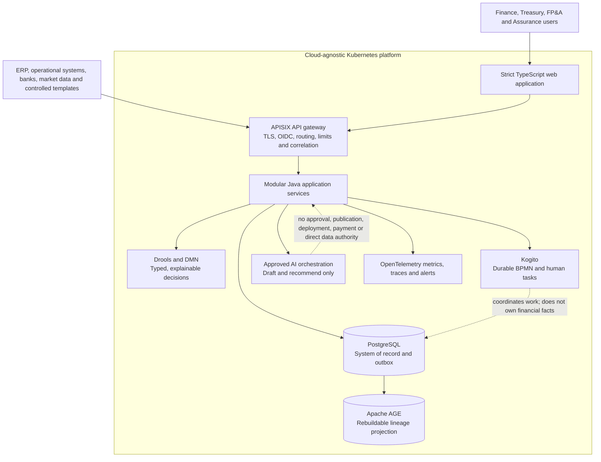
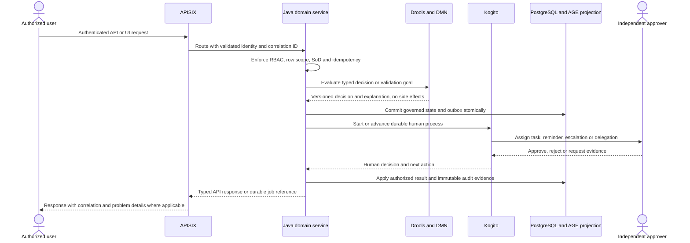
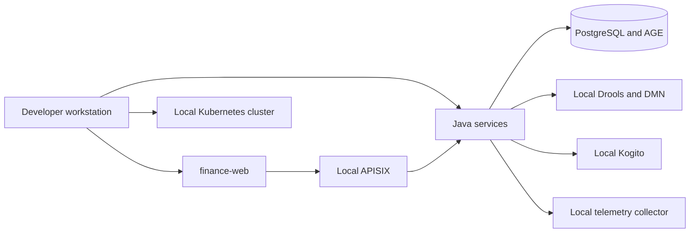
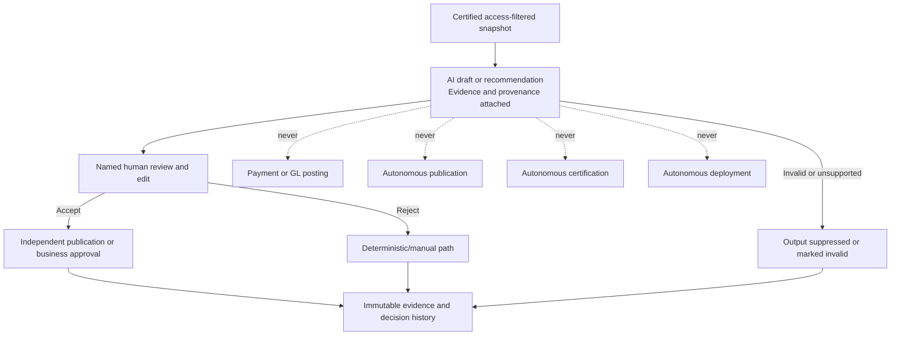
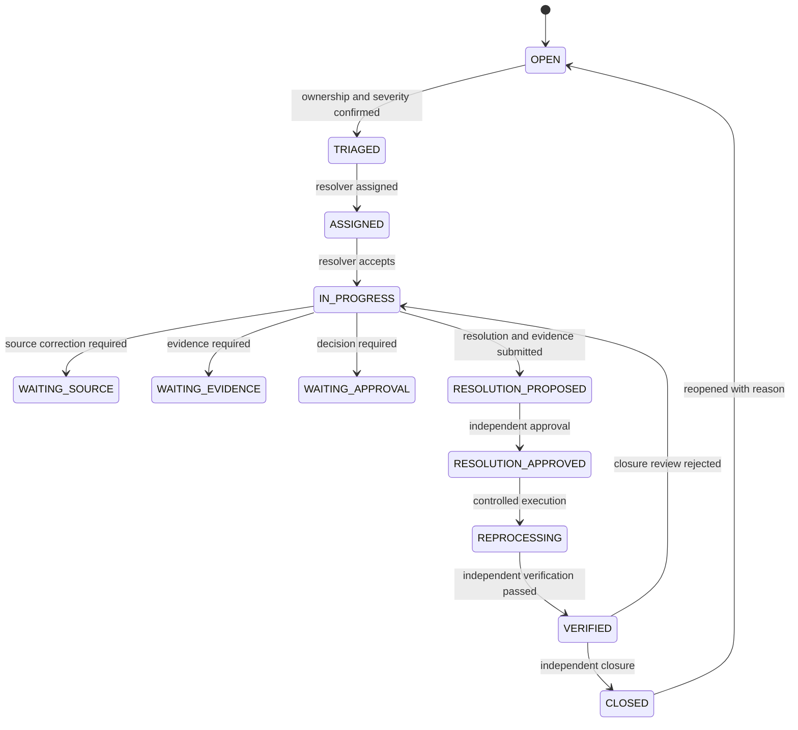
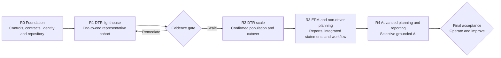

# AI-Empowered Financial Management Solution

A governed financial management platform for enterprise performance reporting, daily treasury operations, integrated planning, and human-approved AI assistance.

The product establishes one trusted finance data core above existing accounting and operational systems. It validates, reconciles, certifies, and publishes management information; coordinates human approvals and exceptions; and uses AI only for evidence-grounded drafting, recommendations, and bounded analysis.

> **Repository status:** This repository currently contains the product requirements and architecture baseline. Implementation source code, deployment manifests, and executable examples have not yet been committed. Commands and paths below are the intended repository conventions, not currently runnable application commands.

---

## Table of Contents

- [AI-Empowered Financial Management Solution](#ai-empowered-financial-management-solution)
  - [Table of Contents](#table-of-contents)
  - [Project Overview](#project-overview)
    - [Product Principles](#product-principles)
  - [Why This Product Exists](#why-this-product-exists)
    - [Success Measures](#success-measures)
  - [Key Capabilities](#key-capabilities)
    - [Governed Finance Data Core](#governed-finance-data-core)
    - [Enterprise Performance Management](#enterprise-performance-management)
    - [Daily Treasury](#daily-treasury)
    - [Integrated Planning](#integrated-planning)
    - [Human-in-the-Loop Exception Management](#human-in-the-loop-exception-management)
  - [Explicit Boundaries](#explicit-boundaries)
  - [Architecture](#architecture)
    - [System Context](#system-context)
    - [Request and Control Flow](#request-and-control-flow)
    - [Technology Responsibility Boundaries](#technology-responsibility-boundaries)
  - [Technology Stack](#technology-stack)
  - [Planned Repository Structure](#planned-repository-structure)
  - [Documentation Index](#documentation-index)
  - [Requirements Baseline](#requirements-baseline)
  - [Getting Started](#getting-started)
    - [1. Clone the Repository](#1-clone-the-repository)
    - [2. Review the Requirements](#2-review-the-requirements)
    - [3. Confirm Tooling](#3-confirm-tooling)
    - [4. Current Repository State](#4-current-repository-state)
  - [Local Development Conventions](#local-development-conventions)
    - [Intended Service Commands](#intended-service-commands)
    - [Local Environment Topology](#local-environment-topology)
    - [Development Rules](#development-rules)
  - [Environment Configuration](#environment-configuration)
  - [Testing and Quality Gates](#testing-and-quality-gates)
    - [Performance Targets](#performance-targets)
  - [Kubernetes Deployment Model](#kubernetes-deployment-model)
    - [Deployment Principles](#deployment-principles)
    - [Planned Environments](#planned-environments)
    - [Recovery Requirements](#recovery-requirements)
  - [Security, Privacy, and AI Controls](#security-privacy-and-ai-controls)
    - [Mandatory Controls](#mandatory-controls)
    - [AI Authority Boundary](#ai-authority-boundary)
  - [Human-in-the-Loop Playbook](#human-in-the-loop-playbook)
    - [Common Case States](#common-case-states)
    - [Covered Scenarios](#covered-scenarios)
  - [Release Plan](#release-plan)
  - [Contributing](#contributing)
    - [Suggested Commit Format](#suggested-commit-format)
  - [Troubleshooting](#troubleshooting)
    - [No build command exists yet](#no-build-command-exists-yet)
    - [AGE is unavailable after restore](#age-is-unavailable-after-restore)
    - [A timer appears to approve or close work](#a-timer-appears-to-approve-or-close-work)
    - [AI returns a number not present in cited evidence](#ai-returns-a-number-not-present-in-cited-evidence)
  - [Frequently Asked Questions](#frequently-asked-questions)
    - [Is this an ERP or statutory consolidation replacement?](#is-this-an-erp-or-statutory-consolidation-replacement)
    - [Can AI approve a forecast, post an adjustment, or publish a report?](#can-ai-approve-a-forecast-post-an-adjustment-or-publish-a-report)
    - [Why use both Drools and Kogito?](#why-use-both-drools-and-kogito)
    - [Why use Apache AGE if PostgreSQL is already required?](#why-use-apache-age-if-postgresql-is-already-required)
    - [Can the platform run outside one cloud provider?](#can-the-platform-run-outside-one-cloud-provider)
  - [Repository Checklist Before Public Release](#repository-checklist-before-public-release)
  - [License](#license)

---

## Project Overview

Finance organizations commonly assemble management reporting, treasury positions, forecasts, and plans from multiple ERPs, spreadsheets, bank files, and operational systems. This creates repeated manual handling, inconsistent metric definitions, unclear source precedence, and limited auditability.

This product provides:

- A governed semantic and control layer shared by EPM, treasury, and planning.
- Immutable source evidence, validation, reconciliation, certification, and audit history.
- Daily treasury workflows, cash visibility, facility headroom, covenant monitoring, and forecasts.
- Budget and Forecast versions, integrated P&L/BS/CF planning, scenarios, and allocations.
- Deterministic rules and processes with clearly separated human authority.
- Optional, evidence-grounded AI assistance that cannot approve, publish, post, pay, deploy, or certify autonomously.

### Product Principles

1. **One relational system of record:** PostgreSQL owns financial facts and governed state.
2. **Projection, not a second master:** Apache AGE stores rebuildable relationship and lineage projections.
3. **Deterministic truth, durable process:** Drools/DMN make decisions; Kogito coordinates work; Java commits authoritative state.
4. **Human accountability:** Named people approve, certify, publish, adjust, and close exceptions.
5. **Cloud portability:** Kubernetes deployment avoids provider-specific financial logic.
6. **Type safety:** Strict TypeScript at the frontend boundary and typed Java APIs at the backend boundary.
7. **Reproducibility:** Schema, rules, process definitions, prompts, tests, and infrastructure are versioned.

---

## Why This Product Exists

The intended operating model is to move finance teams from manual collection and reconciliation to exception-based management:

| Current friction | Product outcome |
|---|---|
| Repeated spreadsheet handling and email-based approvals | Guided submission, validation, task queues, and durable cases |
| Local KPI variants and report-specific calculations | Certified KPI catalog with formula, grain, owner, cadence, and lineage |
| Late or incomplete daily treasury information | Entity calendars, late/missing queues, and cutoff-based escalation |
| Unclear cash, facility, or intercompany positions | Reconciled cash, deposits, facilities, matching, and covenant headroom |
| Disconnected plans and actuals | Shared dimensions, versions, integrated statements, and variance analysis |
| Offline adjustments and overwritten files | Immutable evidence, adjustment ledger, four-eyes approval, and reversible entries |
| Unsupported AI narratives | Certified snapshots, access-filtered grounding, evidence links, and human publication approval |

### Success Measures

These are proposed acceptance targets rather than achieved benchmarks:

| Outcome | Proposed target |
|---|---:|
| Certified executive KPIs with owner, formula, grain, lineage, and access policy | 100% of in-scope KPIs |
| In-scope submissions receiving validation and reconciliation outcomes | 100% |
| Certified daily position after last valid on-time submission | ≤ 60 minutes |
| Material adjustments with four-eyes approval and evidence | 100% |
| Recurring packs produced from the governed platform by final release | ≥ 90% |
| AI numeric claims matching cited certified evidence | 100%; unsupported claims blocked |
| Monthly production availability excluding approved maintenance | ≥ 99.9% |

---

## Key Capabilities

### Governed Finance Data Core

- Effective-dated entities, charts, dimensions, mappings, and hierarchies.
- Authoritative source register and data contracts.
- Scheduled integrations and validated spreadsheet/CSV intake.
- Immutable landing, content hashes, load logs, and revision history.
- Rule-based validation, quarantine, reconciliation, and certification.
- Certified KPI and semantic catalog.
- Relational lineage plus rebuildable Apache AGE impact analysis.
- Fixed-precision money, UTC recorded time, and separate effective dates.

### Enterprise Performance Management

- Enterprise, division, and entity management reporting.
- Flash, business-review, and board-style packs.
- Certified dashboards, drill-down, and governed self-service analysis.
- Weekly KPI and monthly actual refresh with controlled republication.
- Commentary, review, approval, publication, and action tracking.
- Governed Excel, PDF, and presentation exports.

### Daily Treasury

- Daily entity calendars, submissions, cutoffs, reminders, and late queues.
- Cash position and direct cash-flow movement.
- Bank, account, currency, and entity drill-down.
- Deposit schedules and facility limits, utilization, availability, and headroom.
- Intercompany loan matching and mismatch management.
- Versioned gearing and covenant formulas with headroom and alerts.
- Configurable rolling cash forecasts and optional stock/unit liquidity context.

### Integrated Planning

- Shared planning dimensions and multi-currency treatment.
- Budget and Forecast versions, seeding, comparison, locks, and controlled reopening.
- Non-driver revenue, operating cost, capital, and workforce schedules.
- Integrated P&L, balance sheet, and cash-flow generation.
- Planning calendar, tasks, multi-level approval, delegation, and reminders.
- Actuals variance and KPI planning.
- Driver-based scenarios, allocations, and management-only intercompany eliminations.

### Human-in-the-Loop Exception Management

- Durable exception cases for data, reconciliation, workflow, model, and operations.
- Four-eyes adjustment approval and linked compensating reversals.
- Timer-based reminders and escalation without automatic approval or closure.
- Delegation, break-glass access, independent verification, and post-event review.
- AI override, evidence-linked review, and a tested kill switch.

---

## Explicit Boundaries

The product deliberately excludes the following unless separately approved:

- Replacing transactional accounting systems.
- Replacing statutory consolidation or statutory reporting.
- Autonomous payments or movement of funds.
- General-ledger posting.
- Autonomous certification, publication, adjustment application, or financial approval.
- Arbitrary natural-language SQL, Cypher, DRL, or model-code execution.
- Ungrounded AI or unapproved training on customer data.
- Native mobile applications; the baseline is responsive browser delivery.

---

## Architecture

### System Context



### Request and Control Flow



### Technology Responsibility Boundaries

| Technology | Owns | Does not own |
|---|---|---|
| Kubernetes | Portable scheduling, scaling, rollout, health and isolation | Financial semantics, approval authority or data truth |
| Java backend | Domain invariants, transactions, entitlements, integrations and authoritative APIs | Browser-only validation or hidden financial side effects |
| TypeScript frontend | Accessible workflows, generated types, runtime input validation and user intent | Authoritative calculation, entitlements, secrets or direct database access |
| APISIX | Edge authentication integration, routing, rate limits, correlation and canary control | Entity authorization, SoD, certification or workflow decisions |
| PostgreSQL | Facts, mappings, revisions, versions, adjustments, certification and outbox | Independently edited graph relationships |
| Apache AGE | Stable-ID lineage, hierarchy, intercompany and impact projections | A second financial master or final evidence store |
| Drools | Forward- and backward-chained deterministic inference | Side effects, workflow ownership or unbounded recursion |
| DMN | Inspectable decision tables and approval-level selection | Opaque or mutating financial decisions |
| Kogito | Durable process, human tasks, timers, escalation and compensation | Financial fact ownership or timer-based approval |
| AI orchestration | Grounded drafts, bounded answers and recommendations | Self-approval, publication, deployment, payment, posting or direct data access |

---

## Technology Stack

| Layer | Selected technology | Responsibility |
|---|---|---|
| Container platform | Cloud-agnostic Kubernetes | Portable deployment, scaling, rollout, policy and isolation |
| Backend | Java | Domain services, transactional invariants and integrations |
| Frontend | Strict type-safe TypeScript | Accessible finance workflows and generated API contracts |
| API gateway | APISIX | Edge security, routing, request controls and observability propagation |
| Relational database | PostgreSQL | Financial system of record, workflow correlation and outbox |
| Graph projection | Apache AGE | Rebuildable lineage and impact graph inside PostgreSQL |
| Rule engine | Drools | Forward- and backward-chained deterministic reasoning |
| Decision model | DMN | Business-readable decision tables and approvals |
| Process automation | Kogito | Cloud-native BPMN, human tasks, timers and compensation |
| AI | Approved model route or service | Certified-snapshot grounding, drafting, recommendations and evaluation |
| Observability | OpenTelemetry-compatible instrumentation | Metrics, traces, logs, freshness, queues and alert evidence |

---

## Planned Repository Structure

The implementation should use a monorepo organized around product deployables and governed assets.

```text
.
├── README.md
├── docs/
│   ├── architecture/
│   ├── decisions/
│   ├── runbooks/
│   └── operations/
├── apps/
│   └── finance-web/              # Strict TypeScript frontend
├── services/
│   ├── finance-core/             # Java domain and transactional services
│   ├── finance-integration/      # Ingestion, templates and source contracts
│   ├── finance-planning/         # Versions, models and planning workflow
│   ├── finance-reporting/        # Semantic, packs, exports and AI orchestration
│   └── finance-admin/            # Master data, entitlements and cases
├── rules/
│   ├── drools/                   # Versioned rule assets and tests
│   └── dmn/                      # Versioned decision models and fixtures
├── processes/
│   └── bpmn/                     # Versioned Kogito process definitions
├── db/
│   ├── migrations/               # Expand, migrate and contract changes
│   ├── fixtures/                 # Representative controlled test data
│   └── graph/                    # AGE projection build and verification
├── deploy/
│   ├── kubernetes/               # Environment overlays and policies
│   ├── apisix/                   # Gateway routes, plugins and canary config
│   └── observability/            # Dashboards, alerts and collectors
├── config/
│   └── environments/             # Non-secret environment configuration
├── scripts/
│   ├── setup/                    # Local bootstrap helpers
│   ├── quality/                  # Contract, rule and security checks
│   └── operations/               # Backup, restore and verification helpers
└── tests/
    ├── contract/
    ├── integration/
    ├── e2e/
    ├── performance/
    ├── security/
    └── ai-evaluation/
```

---

## Documentation Index

| Document | Purpose |
|---|---|
| [AI-Empowered Financial Management PRD](./AI_Empowered_Financial_Management_PRD.md) | Product requirements, functional scope, NFRs, acceptance criteria and release plan |
| `docs/architecture/` | Component, data, integration and deployment decisions |
| `docs/decisions/` | Architecture decision records with alternatives and consequences |
| `docs/runbooks/` | Operational recovery, incident, migration and support procedures |
| `docs/operations/` | Service-level objectives, observability and cost-management guidance |

---

## Requirements Baseline

The PRD currently defines:

| Artifact | Count |
|---|---:|
| Product personas | 5 |
| User stories | 15 |
| Functional features | 44 |
| Must / Should / Could / Won’t priorities | 23 / 13 / 6 / 2 |
| Given–When–Then acceptance criteria | 101 |
| General NFRs | 40 |
| Dedicated human-in-the-loop NFRs | 12 |
| Human-intervention playbooks | 12 scenarios |
| Mermaid illustrations | 9 |

All priorities, targets, and service levels remain proposed until confirmed through sizing, security review, UAT, and formal acceptance.

---

## Getting Started

### 1. Clone the Repository

```bash
git clone <your-repository-url>
cd <repository-name>
```

### 2. Review the Requirements

Read the PRD before creating implementation issues:

```bash
# Open the PRD in your preferred editor.
# The current working copy is docs/AI_Empowered_Financial_Management_PRD.md
# in the prepared deliverables directory.
```

### 3. Confirm Tooling

The future implementation environment will require:

- Java Development Kit using a supported Java LTS release.
- Node.js and the package manager selected for the frontend.
- Docker or a compatible container runtime.
- `kubectl` and a local Kubernetes cluster such as kind, minikube, or k3d.
- Helm or Kustomize for deployment configuration.
- PostgreSQL with the Apache AGE extension for local and test environments.
- A local APISIX configuration path for gateway development.
- Maven or Gradle for the Java backend build.

### 4. Current Repository State

No source-code build command is available yet. The first engineering milestone should add:

1. Repository skeleton and linting/build conventions.
2. Java service templates with API contract generation.
3. Strict TypeScript application shell.
4. PostgreSQL and Apache AGE local setup.
5. APISIX local gateway configuration.
6. Drools/DMN and Kogito development examples.
7. Contract, security and smoke-test pipelines.
8. The first controlled DTR lighthouse implementation.

---

## Local Development Conventions

### Intended Service Commands

These commands are conventions to implement; they are not available in the current source-only requirements stage.

```bash
# Build all backend modules
./mvnw verify
# or
./gradlew build

# Build the frontend
cd apps/finance-web
npm install
npm run typecheck
npm run lint
npm run test
npm run build

# Run local contract and integration tests
./scripts/quality/verify-contracts.sh
./scripts/quality/verify-rules.sh
./scripts/quality/verify-security.sh

# Create or refresh a local environment
./scripts/setup/create-local-cluster.sh
./scripts/setup/install-local-dependencies.sh
```

### Local Environment Topology



### Development Rules

- The frontend must use generated API types and strict TypeScript; unreviewed `any` is not accepted.
- Money and rates cross API boundaries as strings with explicit currency, scale, and rounding metadata.
- Backend services remain authoritative for validation, RBAC/RLS, SoD, certification, and workflow state.
- Process definitions and rules are versioned assets with independent expected results.
- Long-running operations return durable job resources rather than holding web requests open.
- All test fixtures and representative finance examples are synthetic.

---

## Environment Configuration

Configuration below is planned; exact names must be defined in the initial engineering milestone.

| Category | Example variable | Purpose |
|---|---|---|
| API | `API_BASE_URL` | Frontend API origin |
| Identity | `OIDC_ISSUER`, `OIDC_CLIENT_ID`, `OIDC_SCOPES` | SSO and token validation |
| Database | `POSTGRES_URL`, `POSTGRES_USER`, `POSTGRES_PASSWORD_REF` | Relational system of record |
| Graph | `AGE_GRAPH_NAME`, `AGE_REBUILD_ENABLED` | AGE projection and rebuild controls |
| Gateway | `APISIX_ADMIN_URL`, `APISIX_ADMIN_TOKEN_REF` | Gateway configuration |
| Rules | `RULES_PACKAGE_VERSION`, `DMN_MODEL_VERSION` | Decision asset versions |
| Process | `KOGITO_PERSISTENCE_ENABLED`, `PROCESS_VERSION` | Durable process settings |
| AI | `AI_ENABLED`, `AI_ROUTE_ID`, `AI_MODEL_VERSION` | Approved AI feature controls |
| Telemetry | `OTEL_EXPORTER_OTLP_ENDPOINT` | Metrics, traces and logs |
| Security | `ENCRYPTION_KEY_REF`, `SECRET_PROVIDER` | Managed key and secret references |

Secrets must not be committed. Use environment-specific secret references, local secret files excluded from Git, or the approved external secret manager.

---

## Testing and Quality Gates

A release must not pass because generated tests pass. Financial results and controls require independently authored or reviewed expectations.

| Gate | Required evidence |
|---|---|
| Requirements traceability | Story, feature, acceptance criterion, test, defect and release mapping |
| Financial integrity | Source-to-target, opening/closing, statement, allocation, intercompany and rounding reconciliation |
| Rules and process | Drools/DMN row and boundary tests, termination checks, Kogito restart/timer/compensation tests |
| API and integration | Idempotency, ETag, replay, problem details, contract compatibility and event deduplication |
| Security and privacy | SSO/MFA, RBAC/RLS/SoD, denied access, secrets, encryption, residency and no-training terms |
| Performance and elasticity | Signed workload, p50/p95/p99, concurrency, resource use, backlog recovery and failure tests |
| Resilience | Backup, restore, RPO/RTO, instance loss, process restart, AGE rebuild and manual fallback |
| Accessibility | WCAG 2.2 AA automation and manual keyboard, focus, zoom, contrast and screen-reader tests |
| AI assurance | Grounding, numeric fidelity, access filtering, injection, provenance, override and kill switch |
| Migration | Trial loads, parallel runs, reconciliation, rollback, archive and formal go/no-go |
| Deployment | SBOM, tagged release, clean deployment, rollback/roll-forward, telemetry and current runbooks |

### Performance Targets

All targets require representative workload confirmation:

| Measure | Proposed acceptance target |
|---|---:|
| Daily template validation | p95 ≤ 30 seconds |
| Monthly template validation | p95 ≤ 60 seconds |
| Certified daily position after last valid on-time submission | ≤ 60 minutes |
| Aggregate dashboard load | p95 ≤ 3 seconds |
| Authorized drill to detail | p95 ≤ 5 seconds |
| Standard management pack generation | ≤ 2 minutes |
| Production availability | ≥ 99.9% monthly, excluding approved maintenance |
| Proposed recovery objectives | RPO ≤ 15 minutes; RTO ≤ 4 hours, subject to policy |

---

## Kubernetes Deployment Model

### Deployment Principles

- Use OCI images and declarative Kubernetes manifests.
- Prefer Helm or Kustomize overlays by environment.
- Run at least two failure-domain-separated replicas for stateless production services.
- Apply NetworkPolicies, non-root containers, read-only filesystems, resource requests and limits.
- Autoscale APIs on load and workers on queue age or depth.
- Deploy schema changes through expand, migrate and contract phases.
- Use APISIX canary or blue-green routing with independent rollback decisions.
- Keep provider-specific dependencies outside domain logic.

### Planned Environments

| Environment | Purpose |
|---|---|
| `dev` | Local or shared developer integration |
| `test` | Automated integration and regression |
| `uat` | Controlled business acceptance and parallel runs |
| `prod` | Certified production operation |

### Recovery Requirements

- PostgreSQL point-in-time recovery and controlled failover.
- AGE installed consistently on primary, replica and restore targets.
- Immutable backup and restore evidence.
- Outbox replay and idempotent projection rebuild after recovery.
- Process and timer-state verification after service restoration.
- Independent reconciliation before publication resumes.

---

## Security, Privacy, and AI Controls

### Mandatory Controls

- OIDC SSO with MFA for all interactive production users.
- Server-side RBAC, row-level scope, and segregation of duties.
- Fixed, short-lived service credentials and managed secrets.
- Encryption in transit and at rest with controlled key rotation.
- Full old/new audit history and independently retrievable evidence.
- Approved region, retention, support-access, subprocessor and no-training controls.
- Privileged access management and recorded break-glass sessions.
- No shared production credentials.

### AI Authority Boundary



AI access is limited to Tier 0 deterministic behavior, Tier 1 drafting, and Tier 2 recommendations. Tier 3 autonomous financial authority is denied by design.

---

## Human-in-the-Loop Playbook

Human intervention is part of the non-functional control model, not an optional operational workaround.

### Common Case States



### Covered Scenarios

1. Validation errors.
2. Reconciliation breaks.
3. Late or missing source data.
4. Mapping or KPI changes.
5. Manual adjustments.
6. Approval rejection and resubmission.
7. Intercompany mismatches.
8. Planning model imbalances.
9. Covenant alerts.
10. Invalid or low-confidence AI output.
11. Production or model incidents.
12. Break-glass emergency access.

Timers remind and escalate but never approve, close, certify, publish, post, pay, or apply an adjustment. Case closure and business-object certification remain separate decisions.

---

## Release Plan



A release cannot scale merely because screens are present. Each gate requires functional acceptance, financial reconciliation, security, resilience, deployment evidence, operational readiness, and approved adoption or retirement decisions.

---

## Contributing

1. Create an issue linked to the relevant PRD feature ID or non-functional requirement.
2. Add independently authored acceptance and adversarial cases for financial behavior.
3. Keep PostgreSQL as the authoritative financial system of record.
4. Keep AGE projections rebuildable and watermark-aware.
5. Keep Drools/DMN decisions typed, explainable, terminating, and side-effect-free.
6. Keep Kogito responsible for process state and next action, not financial truth.
7. Keep AI outputs as drafts or recommendations with evidence and human approval.
8. Never bypass backend authorization with frontend or gateway-only checks.
9. Update schema, rules, processes, tests, runbooks, and documentation in the same reviewed change.
10. Do not commit secrets, customer data, or confidential finance information.

### Suggested Commit Format

```text
feat(planning): add plan version approval lock
fix(treasury): preserve original late submission timestamp
test(rules): add covenant zero-denominator boundary case
docs(api): document idempotent submission replay behavior
```

---

## Troubleshooting

### No build command exists yet

**Symptom:** Running Maven, Gradle, or frontend commands fails.

**Reason:** This repository currently contains the product requirements baseline and no committed implementation code.

**Action:** Use the PRD to create the initial engineering milestone and repository skeleton.

### AGE is unavailable after restore

**Checklist:**

1. Confirm the extension is installed on the restored PostgreSQL instance.
2. Verify graph catalog existence and permissions.
3. Rebuild the projection from relational evidence.
4. Compare stable-ID nodes and relationships against relational watermarks.
5. Block dependent certification until graph consistency is verified.

### A timer appears to approve or close work

**Expected behavior:** Timers only remind, reassign, escalate, and change visibility.

**Action:** Treat this as a severity-one process-control defect, disable the affected process version, and restore the last approved version after independent verification.

### AI returns a number not present in cited evidence

**Expected behavior:** The output is suppressed or marked invalid.

**Action:** Reject the draft, retain provenance, rerun the numeric-fidelity evaluation, and keep the deterministic/manual path active.

---

## Frequently Asked Questions

### Is this an ERP or statutory consolidation replacement?

No. The product consumes, validates, reconciles, and analyzes data from existing systems. It does not replace transactional accounting, statutory consolidation, or statutory reporting.

### Can AI approve a forecast, post an adjustment, or publish a report?

No. AI may draft or recommend within approved tiers, but a named human must review and approve consequential decisions.

### Why use both Drools and Kogito?

Drools and DMN provide deterministic decisioning and explanations. Kogito coordinates durable workflows, human tasks, timers, escalation, and compensation. The technologies answer different questions and do not replace each other.

### Why use Apache AGE if PostgreSQL is already required?

PostgreSQL remains the system of record. AGE provides graph traversal and impact analysis over stable relationship projections without introducing a separately governed graph database.

### Can the platform run outside one cloud provider?

Yes. The baseline requires cloud-agnostic Kubernetes and avoids provider-specific financial logic. Managed services may be used where portability, AGE support, backup, restore, and exit behavior are verified.

---

## Repository Checklist Before Public Release

- [ ] Choose and commit a license.
- [ ] Replace repository placeholders with the actual project URL.
- [ ] Add repository security policy and private vulnerability reporting.
- [ ] Add issue templates linked to PRD feature IDs.
- [ ] Add pull-request and code-review templates.
- [ ] Add CODEOWNERS for frontend, Java services, database, rules, processes, security, and documentation.
- [ ] Add initial CI with formatting, compilation, type checks, unit tests and dependency scanning.
- [ ] Add PostgreSQL/AGE local setup and migration verification.
- [ ] Add APISIX local gateway configuration.
- [ ] Add Kogito and Drools/DMN test conventions.
- [ ] Add OpenTelemetry local observability.
- [ ] Add synthetic fixtures only; no customer or confidential finance data.
- [ ] Verify that all README commands and paths match the implemented repository.

---
 
## License

A license has not yet been selected. Add an explicit license before public publication or reuse.

---

**Current source of truth:** [Product Requirements Document](./docs/AI_Empowered_Financial_Management_PRD.md)
