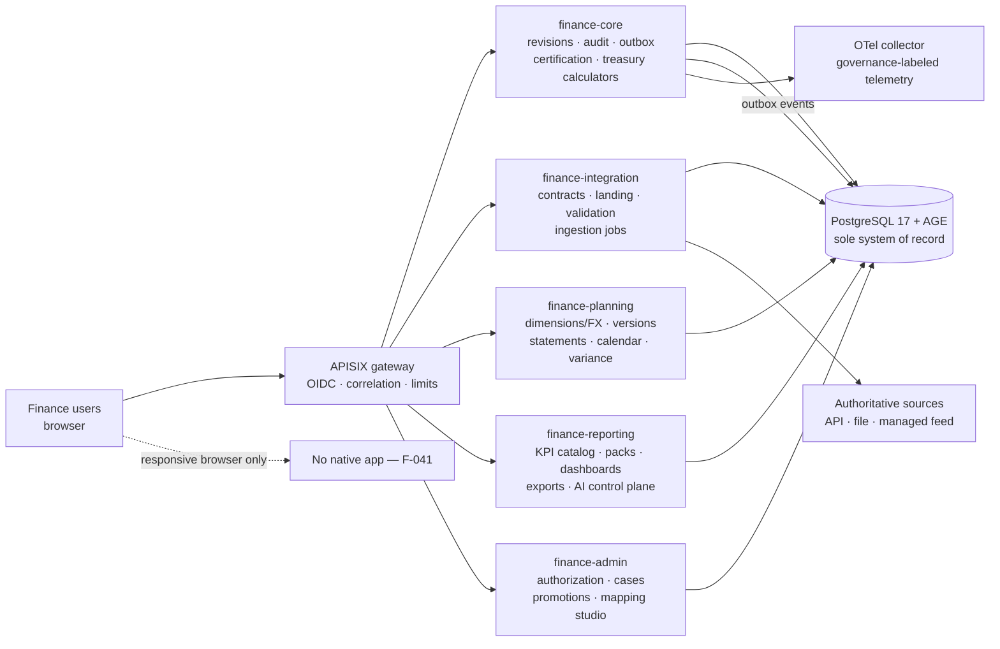

# System Overview

The platform is a five-service monorepo on a locked stack (see
`../decisions/version-matrix.md`): Java 21 / Quarkus 3.15.7 services against
PostgreSQL 17 with the AGE extension (lineage is projected into a graph; PostgreSQL
remains the sole system of record), a React 19 + Vite frontend, an APISIX gateway in
front, Keycloak for OIDC, and an OpenTelemetry collector for telemetry.

## Container diagram

## Service responsibilities

| Service | Owns | Key internal capabilities (documented in `architecture/`) |
|---|---|---|
| finance-core | Object/revision identity, immutable audit, transactional outbox, idempotency, certification, treasury calculators, adjustment controls, delegation/break-glass primitives | Cash position, funding headroom, covenant, forecast calculators; `RevisionService` gap-free revisions via advisory locks |
| finance-integration | Source register/contracts, immutable landing, deterministic validation, ingestion scheduling, durable jobs, migration runner, connectors allowlist | Contract precedence lifecycle; content-addressed landing; `SKIP LOCKED` job claims |
| finance-planning | Dimensions/FX, plan versions, schedules/statements, calendar, variance, drivers/scenarios, allocations, eliminations | `FxTranslationService` (exact approved-rate match), `IntegratedStatementService` (`icstm-1.0.0`), `ScenarioService`, `AllocationService` (`alloc-1.0.0`), `EliminationService` |
| finance-reporting | KPI catalog, report editions/publication, packs, dashboards, exports, AI control plane | `KpiEvaluator`, `ManagementReportService`, `DashboardService`, `ExportFormatService`, `DeterministicCommentaryService`, `AiControlPlane` |
| finance-admin | Authorization (PRD 6.8.2 matrix), identity, master data, cases, promotions, mapping studio | `AuthorizationService` (fail-closed), `CaseService` state machine, `RuleAdministrationService`, `MappingStudioService` |

## Request and data flow

1. **Ingest**: sources land through contract → immutable landing → deterministic
   validation → quarantine/reconciliation → certification (`certification` is the
   trust gate; nothing uncertified reaches a certified product).
2. **Serve**: certified data products feed treasury outputs (R1–R2), management
   packs and integrated planning (R3), advanced scenarios/AI-grounded surfaces (R4).
3. **Every mutation**: idempotency-keyed, revision-append-only (no updates in
   place), audited with old/new values, outbox events for downstreams, correlation
   propagated across responses → audit → events → telemetry.

## Decision boundaries (ADR-001)

- **PostgreSQL is authoritative**; AGE holds projections only (rebuildable, watermark-gated).
- **Drools/DMN** decide bounded classifications (validation rules, FX status,
  driver validity, allocation validity, elimination action, approval levels);
  **Java services own financial state** — rules never commit.
- **Kogito (embedded, `LightProcessRuntime`)** coordinates human-task sequences
  (exception case, plan approval, planning cycle, AI review); all durable state is
  Java/PostgreSQL-owned; timers only remind/escalate.
- **AI is grounded and human-gated**: all routes ship disabled
  (`config/environments/ai-routes.yaml`); deterministic fallbacks are complete —
  see `ai-authority-boundary.md`.

## Excluded by design

Statutory consolidation (F-043) and autonomous payments/posting/approvals (F-044)
do not exist: no route, rule, process, or timer may pay, post, certify, publish, or
approve autonomously. Adversarial denial tests pin this
(`tests/integration/security/FinalAdversarialTest`).
